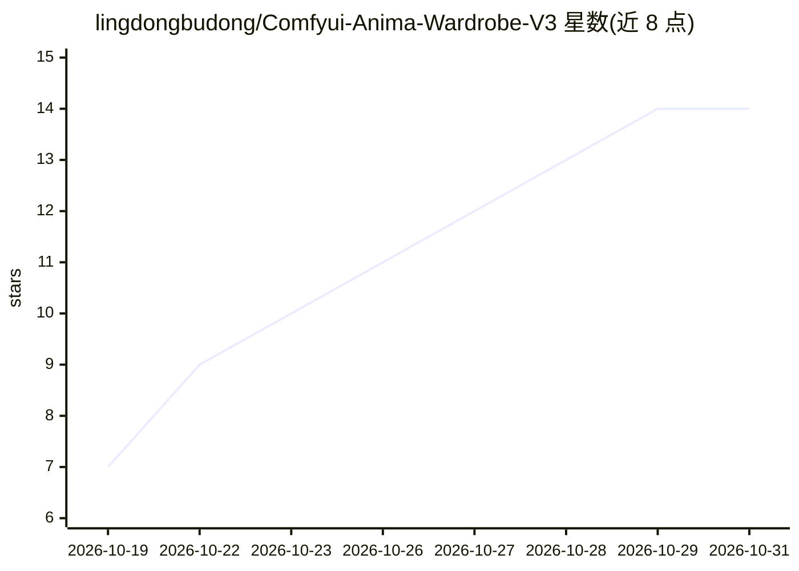

# lingdongbudong/Comfyui-Anima-Wardrobe-V3

⭐ 14 · Python · NOASSERTION · 推送 2026-10-17 · [GitHub](https://github.com/lingdongbudong/Comfyui-Anima-Wardrobe-V3) · 个人维护 · 中文 README

**ComfyUI 节点：ANIMA3 提示词随机生成器，五级 NSFW 闸门**

面向 ComfyUI 用户与 ANIMA3 出图工作流的自定义节点插件：从内置词库（987 词条）与角色库（2383 位女性角色、288 个 IP）随机组合完整提示词正文，STRING 直出可复现、可批量。核心机制为 0–4 五级 NSFW 档位闸门（候选池先按档位收敛、抽完体检回滚）与段/字段/选项三层权重（0=关闭，3.0=必现）。另提供分级审查、拼接、检查修复三个辅助节点。纯 Python + 原生 JS，零第三方依赖，git clone 到 custom_nodes 即装。词库含成人内容，限 18 岁以上，默认 SFW 档。

## 筛选速览

| 维度 | 判定 | 备注 |
|---|---|---|
| AI 角色 | `ai-ecosystem` | LLM/agent 周边工具 |
| 许可风险 | `none` | NOASSERTION |
| 部署形态 | `desktop` | 安装包/桌面程序 |
| 模型依赖 | — | README 未给出锁定关系 |
| 硬件要求 | — | 无带数字的原话,不猜 |
| 安装摩擦 | `low` | 无编译、无系统依赖或容器化 |
| 成熟度 | — | 结构信号不足 |

## 能力要点

- 五级 NSFW 档位闸门：低档先从候选池排除，抽完超档回滚
- 三层权重体系：段 / 字段 / 选项，0=关闭、3.0=必现
- 2383 位女性角色库（288 个 IP），支持角色选择 / 随机池 / 巨乳开关
- 零第三方依赖，纯本地运行，STRING 输出可复现可批量

## 适用场景

- ANIMA3 出图工作流中自动生成随机提示词
- 按 NSFW 档位控制生成内容的露骨程度
- 指定作品 IP 或角色批量出图

## 场景标签

 · 领域:AI 图像生成/ComfyUI 插件

## 证据(README 行号)

> L8: > ANIMA3 提示词随机生成插件 —— 按五级 NSFW 档位随机组合一段完整正文，
> L72: |`AnimaV3RandomPrompt` **Anima 提示词随机生成（V3）**|AnimaWardrobeV3|`nsfw_level` 档位 `seed` -1=每次重抽 `tag_cap` 标签数上限 `base_p

## 星数曲线

2026-10-19 7 → 2026-10-31 14（+7）

---
*卡片 v1 · prompt 1.4 · 生成 2026-10-31 · 置信度 high · 依据 README sha `48a6552765f5` · [字段定义](../../DATASET.md)*
