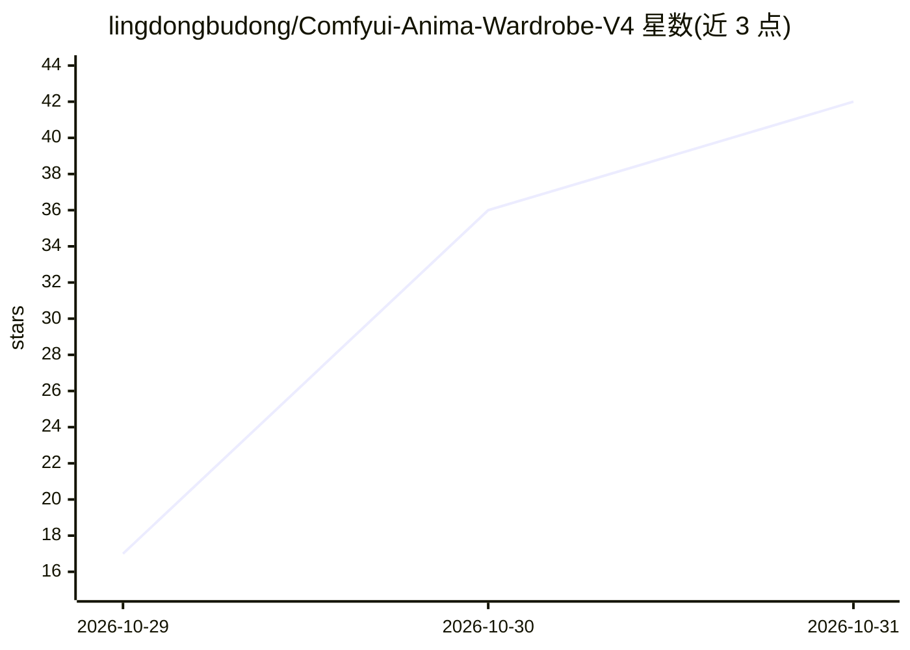

# lingdongbudong/Comfyui-Anima-Wardrobe-V4

⭐ 42 · Python · NOASSERTION · 推送 2026-10-28 · [GitHub](https://github.com/lingdongbudong/Comfyui-Anima-Wardrobe-V4) · 个人维护 · 中文 README

**ComfyUI 自定义节点：ANIMA3 提示词随机生成与五级 NSFW 分级管理**

面向 ComfyUI 工作流用户的自定义节点插件，为 Anima_工作流V3 的「全局正文」节点随机生成英文标签串提示词，只生成提示词不生成图片。核心机制：五级 NSFW 档位闸门（候选池先按档位收敛、抽后体检回滚）、段/字段/选项三层权重、判定表+段下限+上抬/下调校准表的档位计算链；内置 2383 位女性角色库（288 个 IP，缩略图覆盖 99.2%）、261 条场景搭配、角色浏览器面板、4 个示例工作流与 22 项离线测试。零第三方依赖（纯 Python + 原生 JS），放入 custom_nodes 重启即用，可与造型台 v2.x 共存。

## 筛选速览

| 维度 | 判定 | 备注 |
|---|---|---|
| AI 角色 | `ai-ecosystem` | LLM/agent 周边工具 |
| 许可风险 | `none` | NOASSERTION |
| 部署形态 | `desktop` | 安装包/桌面程序 |
| 模型依赖 | — | README 未给出锁定关系 |
| 硬件要求 | — | 无带数字的原话,不猜 |
| 安装摩擦 | `low` | 无编译、无系统依赖或容器化 |
| 成熟度 | — | 结构信号不足 |

## 能力要点

- 五级 NSFW 档位闸门：候选池先按档位收敛，抽后体检、超档回滚
- 三层权重体系（段/字段/选项），0=关闭，3.0=必现
- 角色库 2383 位（288 个 IP）+ 场景库 261 条，带缩略图浏览器与按作品随机池
- 四个节点：随机生成、分级审查、拼接台、检查与修复；22 项离线测试可脱离 ComfyUI 运行

## 适用场景

- 在 ComfyUI 工作流中按档位随机生成 Anima 提示词正文
- 控制出图内容的 NSFW 分级上限，防止高档内容漏进低档
- 按作品 IP 选定或随机抽取角色生成提示词
- 对已有提示词做分级审查与自动修复

## 场景标签

`提示工程` · 领域:Agent 开发

## 证据(README 行号)

> L11: > ANIMA3 提示词随机生成插件 —— 按五级 NSFW 档位随机组合一段完整正文，
> L32: # 1. 插件放进 custom_nodes（没有依赖要装）
> L46: |`tests/`|22 项离线测试 + UI 冒烟 + 夹具：`python tests/run_all.py`（不需要 ComfyUI 运行）|

## 星数曲线

2026-10-29 17 → 2026-10-31 42（+25）

---
*卡片 v1 · prompt 1.4 · 生成 2026-10-30 · 置信度 high · 依据 README sha `a6f6e7264fe8` · [字段定义](../../DATASET.md)*
