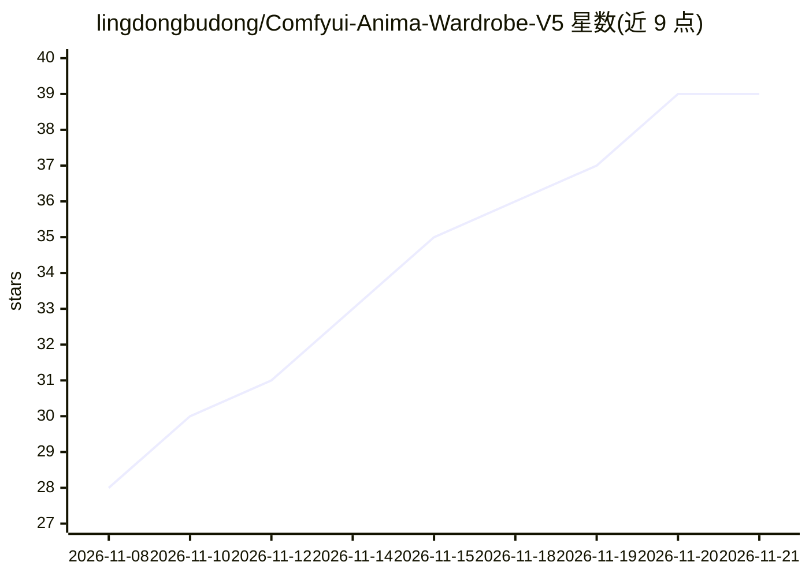

# lingdongbudong/Comfyui-Anima-Wardrobe-V5

⭐ 39 · Python · GPL-3.0 · 推送 2026-11-02 · [GitHub](https://github.com/lingdongbudong/Comfyui-Anima-Wardrobe-V5) · [官网](https://github.com/lingdongbudong/Comfyui-Anima-Wardrobe-V5) · 个人维护 · 中文 README

**ComfyUI 自定义节点：按五级 NSFW 档位随机生成 ANIMA3 提示词**

将浏览器单文件工具「ANIMA提示词生成器.html」的词库资产搬进 ComfyUI 的插件，含四个节点：提示词随机生成、分级审查、拼接台、检查与修复。机制为按五级档位先收敛候选池再随机组合、抽后自检回滚，同 seed 结果逐字可复现；配 2390 角色 / 271 场景搭配与三层权重。纯 Python 标准库、零依赖、运行时零联网，只输出 STRING 提示词不生成图片，也不调用大模型。内含成人向词库，默认 sfw 档，声明仅限 18 岁以上。词库唯一真源 HTML 文件不随仓库分发，但读词库与跑节点不需要它。

## 筛选速览

| 维度 | 判定 | 备注 |
|---|---|---|
| AI 角色 | `ai-ecosystem` | LLM/agent 周边工具 |
| 许可风险 | `viral` | GPL-3.0 |
| 部署形态 | `None` |  |
| 模型依赖 | — | README 未给出锁定关系 |
| 硬件要求 | — | 无带数字的原话,不猜 |
| 安装摩擦 | `low` | 无编译、无系统依赖或容器化 |
| 成熟度 | — | 结构信号不足 |

## 能力要点

- 五级 NSFW 档位闸门：低档先从候选池排除，非抽完再筛
- 2390 角色 / 271 场景搭配 / 三层权重（段/字段/选项）
- 同 seed 同设置正文逐字相同，结果可复现可审计
- 零第三方依赖、运行时零联网，纯标准库 + 原生 JS

## 适用场景

- 在 ComfyUI 出图工作流中自动生成 ANIMA3 正文提示词
- 按档位控制提示词的 NSFW 分级并审查既有提示词
- 批量、可复现地组合角色与场景搭配提示词

## 场景标签

`提示工程` · 领域:Agent 开发

## 证据(README 行号)

> L26: 一个把浏览器单文件工具 `ANIMA提示词生成器.html`（作者：飞蓬）的资产搬进 ComfyUI 的插件：
> L29: 四个节点、零依赖、零联网。与 `Comfyui-Anima-Wardrobe`（造型台 v2.x）**可以同时安装**：
> L49: |**零依赖零联网**|纯 Python 标准库 + 原生 JS。不联网、不上传、不调大模型|

## 星数曲线

2026-11-08 28 → 2026-11-21 39（+11）

---
*卡片 v1 · prompt 1.4 · 生成 2026-11-18 · 置信度 high · 依据 README sha `f3d6f4a1d927` · [字段定义](../../DATASET.md)*
