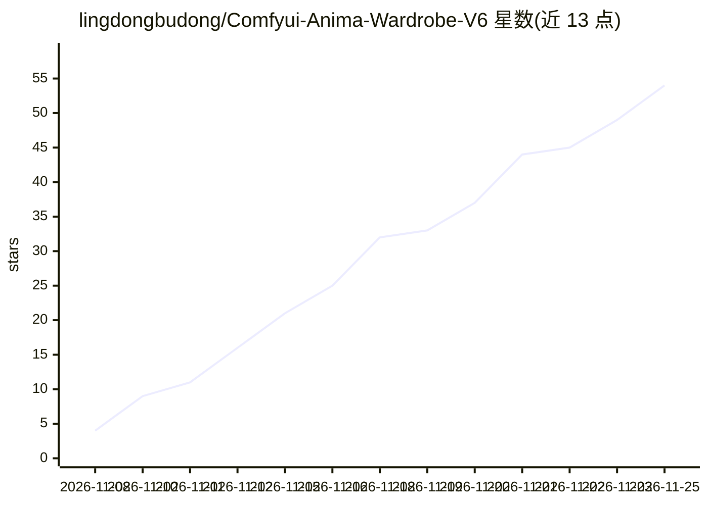

# lingdongbudong/Comfyui-Anima-Wardrobe-V6

⭐ 54 · Python · GPL-3.0 · 推送 2026-11-23 · [GitHub](https://github.com/lingdongbudong/Comfyui-Anima-Wardrobe-V6) · [官网](https://space.bilibili.com/516891894) · 个人维护 · 中文 README

**给 ComfyUI/Anima 出图用户的提示词随机生成节点（含 NSFW 分级）**

ComfyUI 自定义节点插件，面向 Anima 底模的出图工作流：按五级 NSFW 档位闸门随机组合提示词正文，输出 STRING 直连「全局正文」节点，只生成提示词不生成图片。内置角色库 2432 位（带缩略图）、场景搭配 782 条、服装库 167 套（带预览图），支持三层权重（段/字段/选项）、seed 确定性复现、成品自检与自动修复、画幅联动。纯 Python 标准库加原生前端 JS，零第三方依赖、运行时零联网，git clone 到 custom_nodes 后重启即可。面向成人内容创作，限制十八岁以下禁用；角色库不含男性，未上架 ComfyUI Registry。

## 筛选速览

| 维度 | 判定 | 备注 |
|---|---|---|
| AI 角色 | `ai-ecosystem` | LLM/agent 周边工具 |
| 许可风险 | `viral` | GPL-3.0 |
| 部署形态 | `desktop` | 安装包/桌面程序 |
| 模型依赖 | — | README 未给出锁定关系 |
| 硬件要求 | — | 无带数字的原话,不猜 |
| 安装摩擦 | `low` | 无编译、无系统依赖或容器化 |
| 成熟度 | — | 结构信号不足 |

## 能力要点

- 五级 NSFW 档位闸门，候选池先按档位收敛再抽取
- 三层权重体系（段/字段/选项各 0–3）
- 角色库 2432 位 / 场景搭配 782 条 / 服装库 167 套，均带预览图
- seed 固定时逐字节可复现，附带自检与自动修复节点

## 适用场景

- 为 Anima 出图工作流批量生成可控分级的提示词
- 在面板中勾选角色、服装、场景后随机组合提示词
- 对已有提示词跑分级审查与自动修复

## 场景标签

`提示工程` · 领域:Agent 开发

## 证据(README 行号)

> L3: > **ComfyUI 自定义节点：ANIMA3 提示词随机生成器（V6）**
> L4: > 按五级 NSFW 档位随机组合出一整段提示词正文，直接喂给 Anima 出图工作流的「全局正文」节点。
> L79: │ 提示词随机生成（V6） │──text──▶ CR Text（全局正文）──▶ CLIP ──▶ 出图

## 星数曲线

2026-11-08 4 → 2026-11-25 54（+50）

---
*卡片 v1 · prompt 1.4 · 生成 2026-11-18 · 置信度 high · 依据 README sha `4db7bd873f1f` · [字段定义](../../DATASET.md)*
