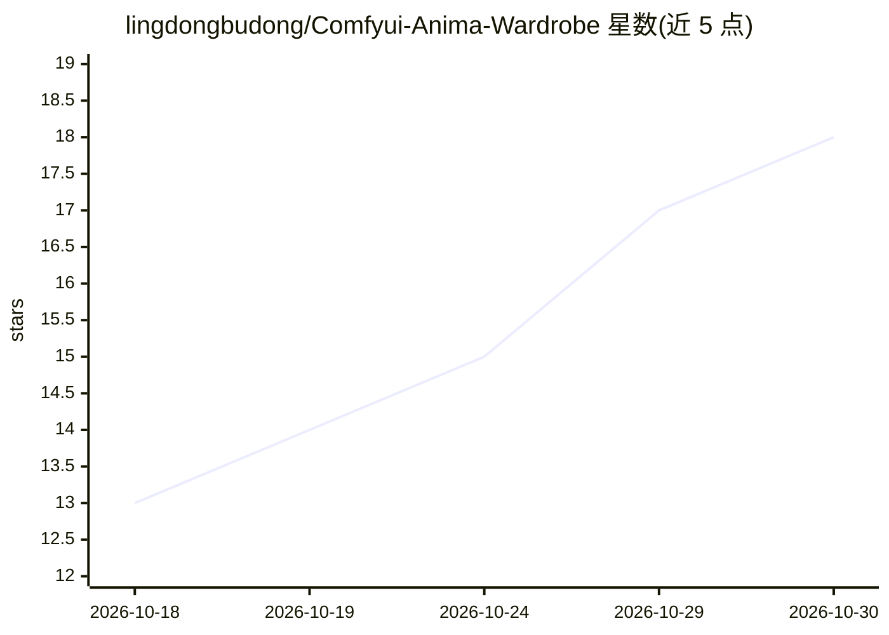

# lingdongbudong/Comfyui-Anima-Wardrobe

⭐ 18 · Python · MIT · 推送 2026-09-29 · [GitHub](https://github.com/lingdongbudong/Comfyui-Anima-Wardrobe) · [官网](https://registry.comfy.org/nodes/comfyui-anima-wardrobe) · 个人维护 · 中文 README

**ComfyUI 自定义节点：动漫角色造型槽位与提示词标签仲裁**

面向 ComfyUI 用户的插件，提供 AnimaWardrobeStudio 造型台、随机女性角色、一键随机搭配、标签仲裁器等 6 个节点，以「槽位契约 + 声明序号」机制裁决多插件向同一提示词写标签的冲突：服装等槽位 sticky 锁定，角色特征等槽位 replaceable 覆盖。内置 5981 角色库与 NSFW 五级抽取规则，输出 Danbooru 风格英文标签。零第三方依赖，预设数据随插件分发，另有同步脚本、73 项契约自检与工作流校验工具。

## 筛选速览

| 维度 | 判定 | 备注 |
|---|---|---|
| AI 角色 | `ai-ecosystem` | LLM/agent 周边工具 |
| 许可风险 | `permissive` | MIT |
| 部署形态 | `None` |  |
| 模型依赖 | — | README 未给出锁定关系 |
| 硬件要求 | — | 无带数字的原话,不猜 |
| 安装摩擦 | `low` | 无编译、无系统依赖或容器化 |
| 成熟度 | — | 结构信号不足 |

## 能力要点

- 槽位契约机制：服装等 sticky 槽先写锁定，角色特征等 replaceable 槽后写覆盖
- 6 个节点：造型台 / 随机角色（5981 个）/ 随机搭配 / 标签仲裁器（最多 4 路）/ 槽位检查器 / 服务端随机
- NSFW 五级抽取（0-4 级）与表情自动匹配、双女关系标签
- 零第三方依赖，空节点逐字节透传，带 73 项契约自检

## 适用场景

- 多个 ComfyUI 插件同时写提示词时避免标签被静默覆盖或过度保护
- 一键抽取互相搭配的动漫角色服装 / 姿势 / 表情 / 场景
- 其他插件作者通过结构化声明或裸文本让自己的标签参与仲裁

## 场景标签

`提示工程` · 领域:Agent 开发

## 证据(README 行号)

> L3: Anima **角色造型台**（服装 / 姿势 / 场景）+ **跨插件标签仲裁器**。
> L32: |`AnimaTagArbiter` **Anima 标签仲裁器**|最多汇总 4 路来源（本插件声明 / 任意插件的裸文本），按契约裁决。**放在链路末端即可保护上游所有插件。**|

## 星数曲线

2026-10-18 13 → 2026-10-30 18（+5）

---
*卡片 v1 · prompt 1.4 · 生成 2026-10-29 · 置信度 high · 依据 README sha `1586cc90fbab` · [字段定义](../../DATASET.md)*
