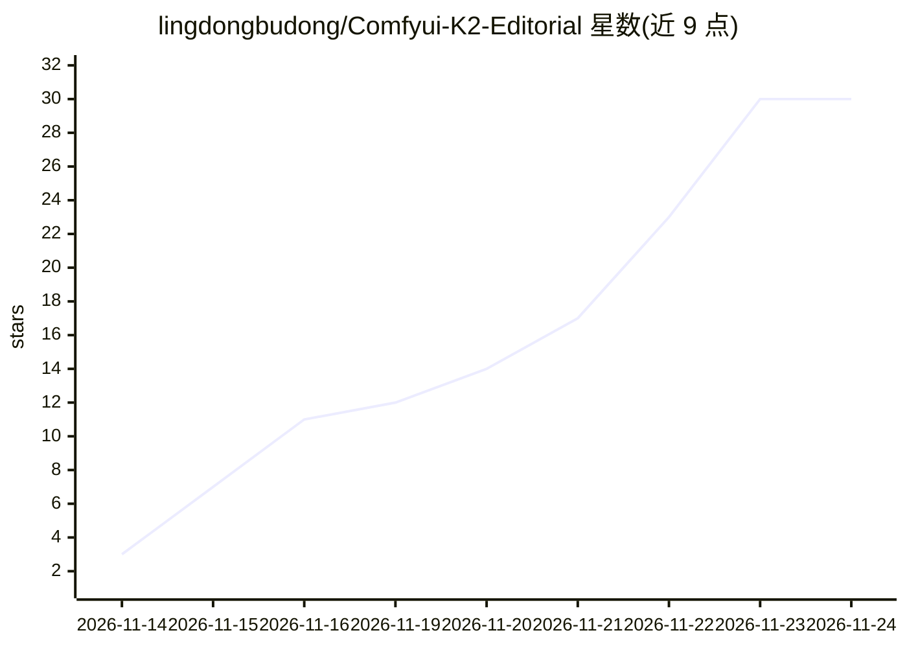

# lingdongbudong/Comfyui-K2-Editorial

⭐ 39 · Python · AGPL-3.0 · 推送 2026-11-23 · [GitHub](https://github.com/lingdongbudong/Comfyui-K2-Editorial) · [官网](https://space.bilibili.com/516891894) · 个人维护 · 中文 README

**给 ComfyUI 用户自动装配 Krea2 长文图像提示词的节点**

一个 ComfyUI 自定义节点，按「母题整块 + 有限替换位」的方式装配英文长提示词（1500–2700 词），母题库 395 条，角色库 2432 位（可与 Comfyui-Anima-Wardrobe-V6 实时同步，未安装时使用内置快照），服装含版型/角色预设/服装库三类。节点只输出 STRING 文本（提示词/自检报告/元数据），不生成图片、运行时零联网、不调用大模型，单次装配约 2.4 ms 且无显存占用。需要 ComfyUI 0.42.x 与 Python ≥ 3.10，无第三方 pip 依赖。

## 筛选速览

| 维度 | 判定 | 备注 |
|---|---|---|
| AI 角色 | `ai-ecosystem` | LLM/agent 周边工具 |
| 许可风险 | `viral` | AGPL-3.0 |
| 部署形态 | `library` | 以包/库形式分发 |
| 模型依赖 | — | README 未给出锁定关系 |
| 硬件要求 | — | 无带数字的原话,不猜 |
| 安装摩擦 | `low` | 无编译、无系统依赖或容器化 |
| 成熟度 | — | 结构信号不足 |

## 能力要点

- 395 条母题 × 2432 位角色，母题决定整张画面构图与光位
- 纯本地零联网、不调用大模型，只生成提示词不生成图片
- 输出 3 个 STRING：提示词、自检报告、元数据
- 无第三方 pip 依赖，支持 git clone 或 ZIP 两种安装方式

## 适用场景

- 在 ComfyUI 工作流中为文生图出题节点批量装配长提示词
- 为 Krea2 白垩光风格主视觉选定角色与母题后生成可复现的提示词
- 用固定种子与缓存失效机制管理母题库改版后的出图一致性

## 场景标签

`提示工程` · 领域:Agent 开发

## 证据(README 行号)

> L11: > ⚠️ **使用边界**：本插件只生成**文字提示词**，不生成图片，运行时零联网、不调用任何大模型。
> L43: [★ K2 长文出题 · 白垩光]  ──提示词(STRING)──▶  CLIP Text Encode (positive)
> L55: 需要 ComfyUI **0.42.x** 与 **Python ≥ 3.10**（实测 3.13），无第三方依赖，不需要 `pip install`。

## 星数曲线

2026-11-14 3 → 2026-11-24 30（+27）

---
*卡片 v1 · prompt 1.4 · 生成 2026-11-18 · 置信度 mid · 依据 README sha `64bd397fbd68` · [字段定义](../../DATASET.md)*
