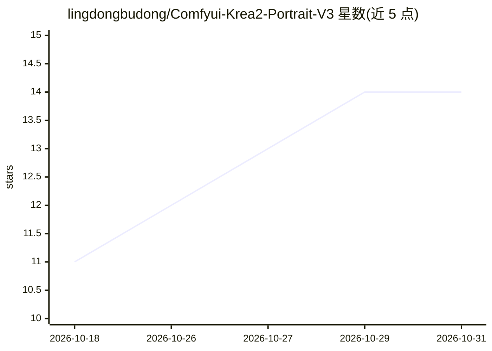

# lingdongbudong/Comfyui-Krea2-Portrait-V3

⭐ 14 · Python · MIT · 推送 2026-10-02 · [GitHub](https://github.com/lingdongbudong/Comfyui-Krea2-Portrait-V3) · 个人维护 · 中文 README

**ComfyUI 摄影人物中文提示词随机生成节点，模板填空、纯本地**

ComfyUI 自定义节点，为 Krea2 文生图工作流生成中文摄影人物提示词：以 63 个随机池 / 949 条中文条目按 10 段模板装配，内置 2165 位角色联动、内容强度五档（默认全年龄，NSFW 内容池默认关闭）、三类权重与可复现种子。只用 Python 标准库，不需要模型、GPU 与网络，插件自身不含出图节点，可仅导出 txt/md/json。含成人向内容开关与知识产权免责声明，输出仅限中文。

## 筛选速览

| 维度 | 判定 | 备注 |
|---|---|---|
| AI 角色 | `ai-ecosystem` | LLM/agent 周边工具 |
| 许可风险 | `permissive` | MIT |
| 部署形态 | `None` |  |
| 模型依赖 | — | README 未给出锁定关系 |
| 硬件要求 | — | 无带数字的原话,不猜 |
| 安装摩擦 | `low` | 无编译、无系统依赖或容器化 |
| 成熟度 | — | 结构信号不足 |

## 能力要点

- 63 池 949 条中文条目按 10 段模板装配成完整提示词
- 2165 位角色联动与外观锁定（crc32 派生，跨运行一致）
- 纯本地零依赖：仅需 Python 标准库 + ComfyUI，不需模型/GPU/网络
- 三个节点：随机出题 / 提示词编辑 / 导出 txt・md・json

## 适用场景

- 文生图前随机获取一条可编辑的中文人物提示词
- 同角色批量产出外观一致的系列提示词
- 不装模型时批量攒词或导出提示词归档

## 场景标签

`提示工程` · 领域:Agent 开发

## 证据(README 行号)

> L3: > **Krea2 工作流专用的「摄影人物提示词」随机生成器**（ComfyUI 自定义节点）。
> L39: |**纯本地、零依赖**|只用 Python 标准库 + ComfyUI 本体；不需要任何模型、GPU、网络|
> L63: ③ 出图               K2V3GeneratorV2 ──▶ CLIPTextEncode ──▶ … ──▶ SaveImage（原生）

## 星数曲线

2026-10-18 11 → 2026-10-31 14（+3）

---
*卡片 v1 · prompt 1.4 · 生成 2026-10-31 · 置信度 high · 依据 README sha `d6123eb4123e` · [字段定义](../../DATASET.md)*
