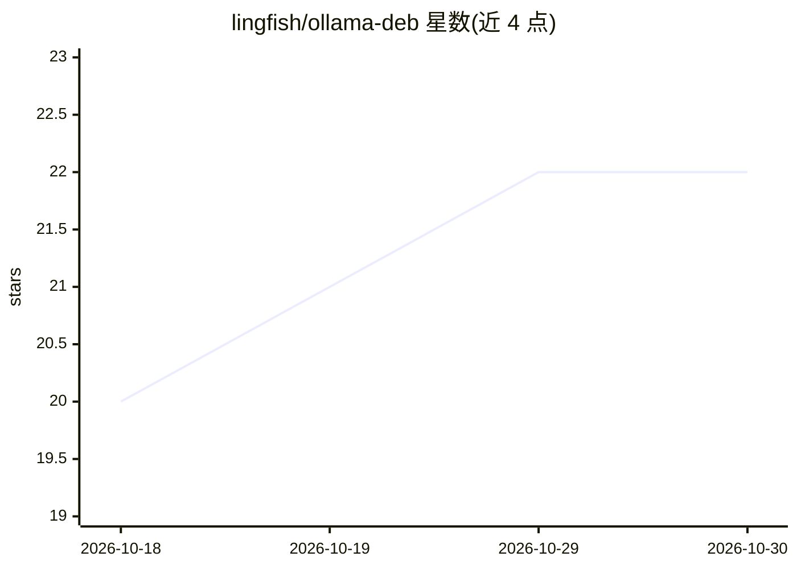

# lingfish/ollama-deb

⭐ 22 · HTML · Apache-2.0 · 推送 2026-10-29 · [GitHub](https://github.com/lingfish/ollama-deb) · 个人维护

**为 ollama 构建 Debian 软件包的 APT 仓库**

由个人维护的 GitHub 工作流项目，基于 ollama 官方 tag 构建 Debian 软件包并通过 APT 仓库（packages.lingfish.net，支持 extrepo）分发。软件包安装与官方二进制 tarball 相同的文件，并额外配置 systemd/init.d 服务、创建运行用户、附带源文档。库拆分为 libollama-common（CPU+Vulkan，必需）、libollama-nvidia（CUDA，可选）、libollama-amd（ROCm，可选），覆盖 amd64 与 arm64 架构，CPU 推理开箱即用。仅托管最新 release 与 rc 版本包。

## 筛选速览

| 维度 | 判定 | 备注 |
|---|---|---|
| AI 角色 | `ai-ecosystem` | LLM/agent 周边工具 |
| 许可风险 | `permissive` | Apache-2.0 |
| 部署形态 | `desktop` | 安装包/桌面程序 |
| 模型依赖 | local-ok | 支持本地模型 |
| 硬件要求 | — | 无带数字的原话,不猜 |
| 安装摩擦 | `low` | 无编译、无系统依赖或容器化 |
| 成熟度 | — | 结构信号不足 |

## 能力要点

- 基于 ollama 官方 tag 自动构建 Debian 包（amd64/arm64）
- 安装时自动配置 systemd 或 init.d 服务并创建运行用户
- 按 CPU/Vulkan、CUDA、ROCm 拆分为三个库包，GPU 包可选
- 支持 extrepo 方式接入 APT 仓库

## 适用场景

- 在 Debian 系统上用 apt 安装和管理 ollama
- 需要 systemd 服务与专用运行用户的 ollama 部署
- 为 NVIDIA/AMD GPU 选择性加装推理后端包

## 场景标签

 · 领域:系统打包/LLM 基础设施

## 证据(README 行号)

> L28: This is a GitHub workflow to build Debian packages of ollama based on tags.
> L33: It will also install, enable and start a service (`systemd` on systemd systems, `init.d` on sysvinit/OpenRC), as we

## 星数曲线

2026-10-18 20 → 2026-10-30 22（+2）

---
*卡片 v1 · prompt 1.4 · 生成 2026-10-28 · 置信度 high · 依据 README sha `da46c0a6e650` · [字段定义](../../DATASET.md)*
