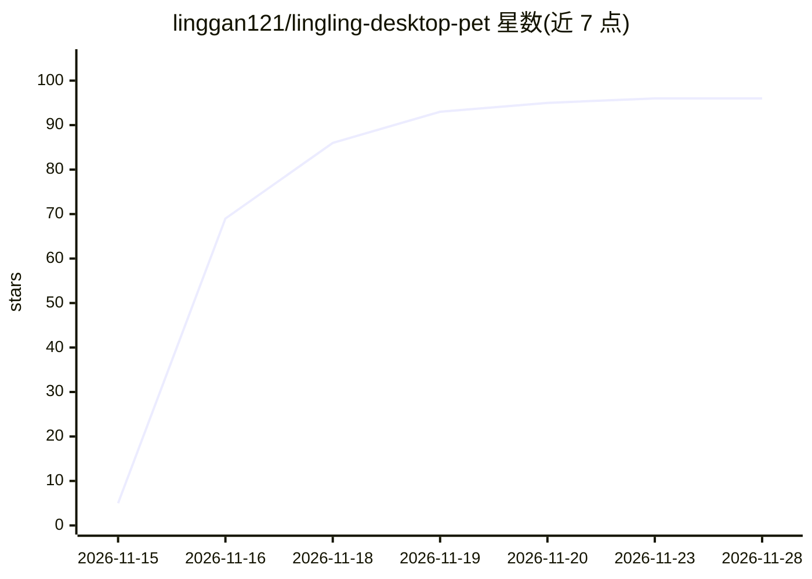

# linggan121/lingling-desktop-pet

⭐ 96 · Python · MIT · 推送 2026-11-16 · [GitHub](https://github.com/linggan121/lingling-desktop-pet) · 个人维护 · 中文 README

**Windows 桌面 AI 桌宠：拖文件即可离线转格式、拆 PDF、提取文字**

基于 Python/tkinter 的 Windows 桌面宠物程序，核心是文件助理：把文件拖到角色上，按文件内容列出编号选项，回数字或自然语言指令即可执行格式转换——图片 30+ 格式、HEIC、图片→PDF、PDF 拆图/提字、Office 提文字、转 Markdown、表格导 CSV、zip/7z 打包解压、视频转 mp4/mp3/gif。转换引擎内置（Pillow/PyMuPDF 等），无需额外安装；仅视频/音频首次使用自动下载 FFmpeg。聊天功能接任意 OpenAI 兼容服务（DeepSeek/豆包/Kimi/OpenRouter/本地 Ollama 等），不配 Key 时文件功能仍可用。限制：拖拽仅在 Windows 验证，素材不在 MIT 授权内。

## 筛选速览

| 维度 | 判定 | 备注 |
|---|---|---|
| AI 角色 | `ai-enhanced` | 去掉 AI 部分产品仍成立 |
| 许可风险 | `permissive` | MIT |
| 部署形态 | `desktop` | 安装包/桌面程序 |
| 模型依赖 | local-ok | 支持本地模型 |
| 硬件要求 | — | 无带数字的原话,不猜 |
| 安装摩擦 | `medium` | 含编译或系统依赖之一 |
| 成熟度 | — | 结构信号不足 |

## 能力要点

- 拖文件→按内容列编号选项→回数字执行的文件转换流程
- 内置转换引擎覆盖 270 种格式，无需额外安装
- 支持接 OpenAI 兼容服务或一键切换本地 Ollama 完全离线
- 文件夹监听模式：新文件自动转换到 converted/

## 适用场景

- 不装工具软件快速转图片/PDF/文档格式
- 接本地 Ollama 做完全离线的桌面 AI 助手
- 让桌宠监听文件夹自动完成日常转换任务

## 场景标签

`AI 助手` · 领域:对话与助手

## 证据(README 行号)

> L32:  - **全部走内置引擎**，不用装任何东西：图片 30+ 格式、HEIC、图片→PDF、PDF 拆图/提字、
> L41: - **会聊天**：接任意 OpenAI 兼容服务（DeepSeek / 豆包 / 硅基流动 / Kimi / 智谱 / 通义 / OpenRouter / 本地 Ollama），流式逐字回复；没配 Key 时只说自己内置的台词；

## 星数曲线

2026-11-15 5 → 2026-11-28 96（+91）

---
*卡片 v1 · prompt 1.4 · 生成 2026-11-18 · 置信度 mid · 依据 README sha `423e8f6b2efb` · [字段定义](../../DATASET.md)*
