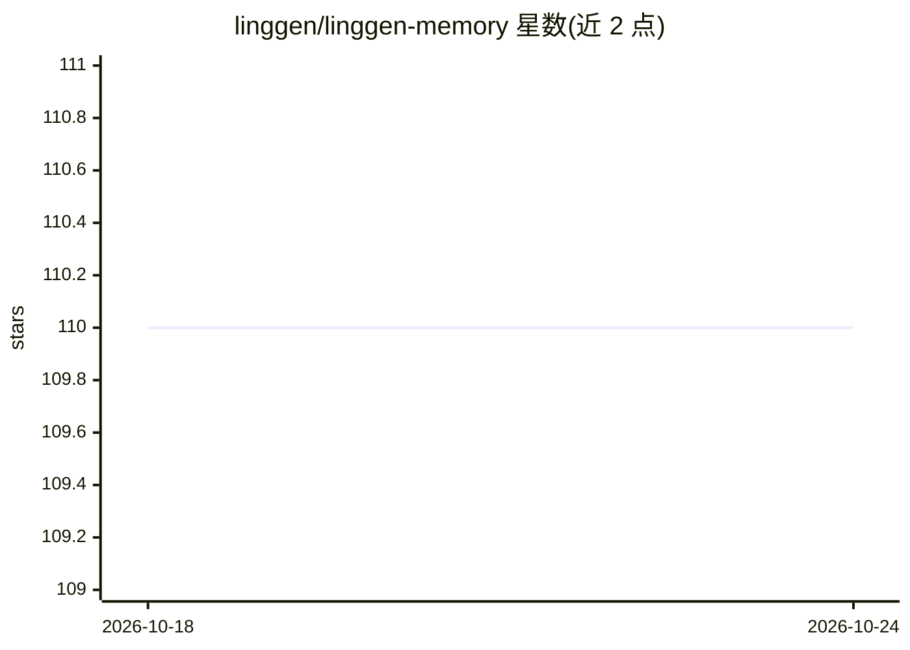

# linggen/linggen-memory

⭐ 110 · Rust · MIT · 推送 2026-10-22 · [GitHub](https://github.com/linggen/linggen-memory) · [官网](https://linggen.dev) · 组织维护

**面向 AI 编程助手的本地优先跨主机共享语义记忆存储**

由 Linggen 维护的本地记忆系统：单一 Rust 二进制 ling-mem 守护进程管理本地存储（LanceDB + Qwen3-Embedding-0.6B），供 Claude Code、Codex、OpenClaw 等多个 agent 共享同一份用户记忆。机制覆盖捕获、按目录范围召回、夜间审阅（dream）、去重合并、矛盾消解与遗忘，记忆分 core/long-term/short-term 三层。通过 CLI、HTTP、MCP 接口访问；含匿名遥测（可关闭）。安装依赖各 agent 的插件市场或 curl 脚本，预编译二进制覆盖 macOS Apple Silicon 与 Linux。

## 筛选速览

| 维度 | 判定 | 备注 |
|---|---|---|
| AI 角色 | `ai-ecosystem` | LLM/agent 周边工具 |
| 许可风险 | `permissive` | MIT |
| 部署形态 | `desktop` | 安装包/桌面程序 |
| 模型依赖 | — | README 未给出锁定关系 |
| 硬件要求 | — | 无带数字的原话,不猜 |
| 安装摩擦 | `medium` | 含编译或系统依赖之一 |
| 成熟度 | — | 结构信号不足 |

## 能力要点

- 单一本地存储被 Claude Code、Codex、OpenClaw 等多个 agent 共享
- 三层记忆结构（core/long-term/short-term）与夜间 dream 审阅任务
- 捕获/召回/合并/矛盾消解/遗忘的完整记忆循环
- 内置 Data Browser 可过滤、编辑、批量删除每条记忆

## 适用场景

- 在 Claude Code 里说过的话，第二天 Codex 能直接知道
- 让不同编程助手共享我的偏好、决策与踩坑记录
- 本地查看和编辑 agent 记住的所有内容

## 场景标签

`Agent 记忆` · 领域:Agent 开发

## 证据(README 行号)

> L37: - **`ling-mem`** — the single binary and local daemon that owns the store (LanceDB + `Qwen3-Embedding-0.6B`, 1024-d
> L40: - **The `linggen` plugin & skill** — the same store inside Claude Code, Codex, and OpenClaw: recall each turn, the 

## 星数曲线

2026-10-18 110 → 2026-10-24 110（+0）

---
*卡片 v1 · prompt 1.4 · 生成 2026-10-24 · 置信度 high · 依据 README sha `5dc53048c421` · [字段定义](../../DATASET.md)*
