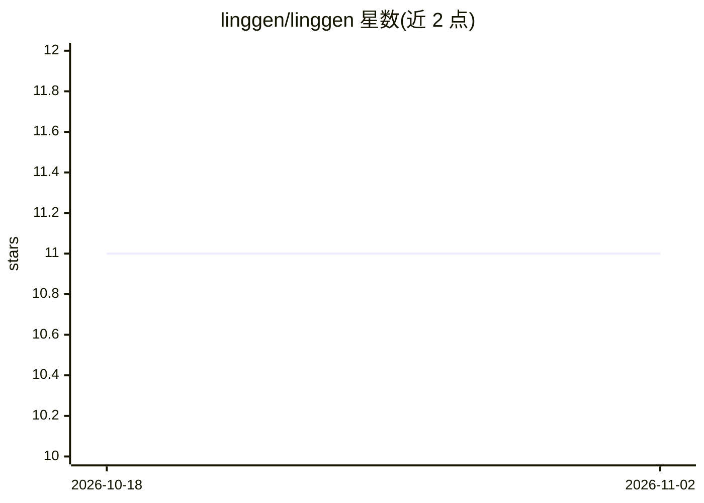

# linggen/linggen

⭐ 11 · Rust · Apache-2.0 · 推送 2026-10-31 · [GitHub](https://github.com/linggen/linggen) · [官网](https://linggen.dev) · 组织维护 · 中文 README

**本地优先的 macOS AI agent 运行时，附带多款个人应用**

面向个人用户的本地优先 AI agent 运行时：核心运行时管理 agent 进程、工具调用、权限与文件式记忆，应用以 markdown+脚本的技能/agent/mission 文件形式即放即用。内置 CFO（本地解析银行账单）、Mac 健康分析、DJ、象棋等应用，以及 VRM 形象桌面伴侣 Yinyue。支持 Ollama、Claude、GPT、Gemini 等多模型路由，通过 P2P WebRTC 共享模型与远程访问，daemon 可作为 MCP server（22 个工具）供 Claude Code/Codex 调用。Mac 应用与 CLI 均通过 curl 脚本安装，Engine 版支持 Linux。

## 筛选速览

| 维度 | 判定 | 备注 |
|---|---|---|
| AI 角色 | `ai-ecosystem` | LLM/agent 周边工具 |
| 许可风险 | `permissive` | Apache-2.0 |
| 部署形态 | `None` |  |
| 模型依赖 | local-ok | 支持本地模型 |
| 硬件要求 | — | 无带数字的原话,不猜 |
| 安装摩擦 | `low` | 无编译、无系统依赖或容器化 |
| 成熟度 | — | 结构信号不足 |

## 能力要点

- 运行时管理 agent 进程、syscall 工具、权限模式与 P2P 房间
- 技能/agent/mission 均为文件，放入 ~/.linggen/ 即用无需重启
- 模型无关：Ollama/Claude/GPT/Gemini 等多模型路由策略
- daemon 暴露 MCP server（22 工具：memory/browser/x/agent_run）

## 适用场景

- 在本地跑个人 AI 应用（账单分析、Mac 体检、音乐 DJ）而不上传数据
- 通过 P2P 把自己的模型共享给朋友使用
- 用 Claude Code/Codex 经 MCP 调用本机记忆与浏览器能力

## 场景标签

`AI 助手` `Agent 框架` · 领域:Agent 开发

## 证据(README 行号)

> L53: Architecturally, Linggen is **the root system for AI agents**. The core
> L57: plugins. The runtime gives every app a process, syscalls (built-in tools),
> L135: The daemon is an MCP server at `http://127.0.0.1:9527/mcp` — 22 tools in

## 星数曲线

2026-10-18 11 → 2026-11-02 11（+0）

---
*卡片 v1 · prompt 1.4 · 生成 2026-11-02 · 置信度 high · 依据 README sha `3260e7d17f05` · [字段定义](../../DATASET.md)*
