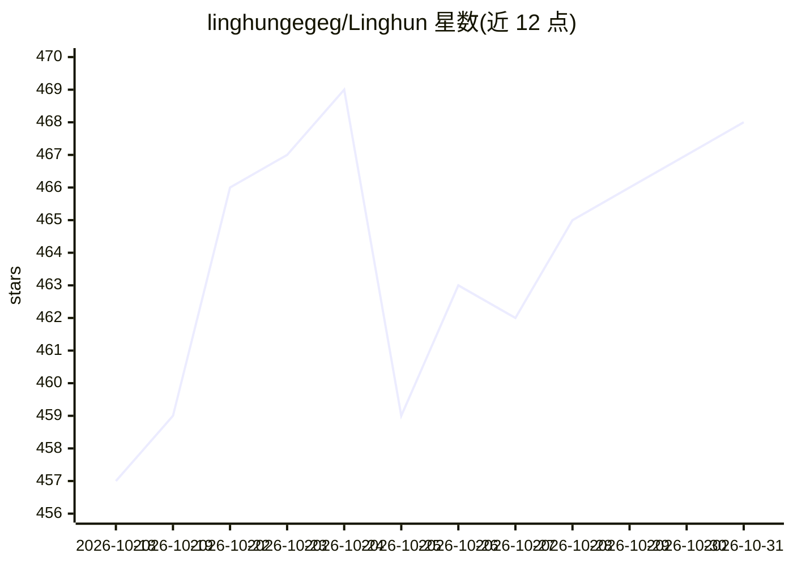

# linghungegeg/Linghun

⭐ 468 · TypeScript · Apache-2.0 · 推送 2026-08-19 · [GitHub](https://github.com/linghungegeg/Linghun) · 个人维护 · 中文 README

**本地优先、证据优先的 AI 编程终端，供开发者用自然语言驱动真实工程闭环**

基于 Node.js 22+ 的命令行 AI 编程工具（npm 全局安装后运行 linghun 启动 TUI），面向个人开发者、新手与企业环境。核心机制：把大模型接入文件读写、Bash、Git、代码索引、验证与权限边界构成的主链，通过 EvidenceSummary、验证分级（PASS/PARTIAL/FAIL/TIMEOUT/STALE/CANCELLED）、最终回答闸门等约束模型输出；支持 OpenAI-compatible、DeepSeek、Anthropic Messages 风格端点与多模型路由、Workflow Matrix 多智能体、受控记忆与失败学习。Windows 与中文环境为一等公民；代码执行默认在本地，API key 存于用户级私有配置。限制：Terminal-Bench 2.1 提交 PR 待合并，场景化收益数字为架构层估计而非测量承诺。

## 筛选速览

| 维度 | 判定 | 备注 |
|---|---|---|
| AI 角色 | `ai-native` | 本体是模型或模型工具 |
| 许可风险 | `permissive` | Apache-2.0 |
| 部署形态 | `desktop` | 安装包/桌面程序 |
| 模型依赖 | locked-api |  |
| 硬件要求 | — | 无带数字的原话,不猜 |
| 安装摩擦 | `low` | 无编译、无系统依赖或容器化 |
| 成熟度 | — | 结构信号不足 |

## 能力要点

- 证据优先反幻觉：关键结论绑定文件读取、工具结果、验证记录与 Git 状态
- 区分聚焦验证/mock/真实 smoke/未验证结论，agent summary 不能冒充 PASS
- 支持多模型路由、Workflow Matrix、durable job 与多智能体长任务托管
- Windows/中文路径/PowerShell 等环境一等公民支持，CLI 随包携带 codebase-memory-mcp 二进制

## 适用场景

- 用中文或中英混合自然语言定位并修复构建失败、跑测试、创建 Git 稳定点
- 在 Windows、中文路径等真实环境中长期维护项目并跨轮沉淀规则与失败经验
- 把规划、执行、审查、验证分给不同模型角色完成复杂工程任务

## 场景标签

`编码 Agent` `多智能体` · 领域:Agent 开发

## 证据(README 行号)

> L19: Linghun 可以理解成：给大模型装上一套工程化外骨骼。模型负责理解、推理和生成；Linghun 负责把模型接到真实项目、真实工具、真实权限、真实验证和真实上下文里。
> L41: Linghun 面向真实开发，而不是只做演示式问答。你可以直接用自然语言让它：
> L370: Linghun 支持 OpenAI-compatible、DeepSeek、Anthropic Messages 风格端点，包含流式输出、工具调用、usage、reasoning、timeout、idle timeout、pro

## 星数曲线

2026-10-18 457 → 2026-10-31 468（+11）

---
*卡片 v1 · prompt 1.4 · 生成 2026-10-21 · 置信度 high · 依据 README sha `9f88f0331ae5` · [字段定义](../../DATASET.md)*
