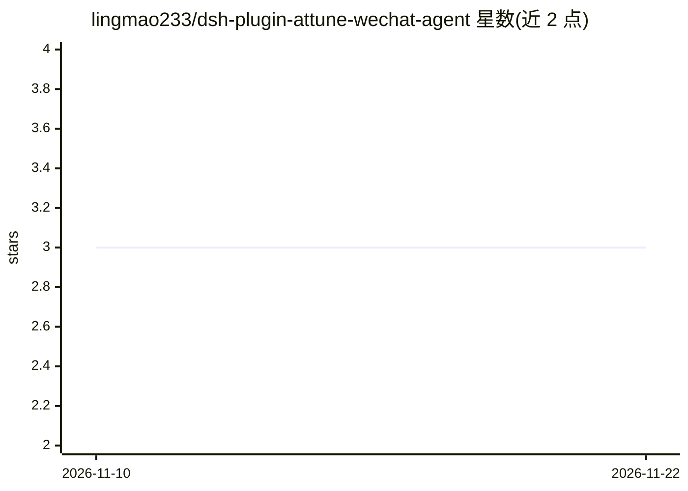

# lingmao233/dsh-plugin-attune-wechat-agent

⭐ 3 · JavaScript · MIT · 推送 2026-11-11 · [GitHub](https://github.com/lingmao233/dsh-plugin-attune-wechat-agent) · 个人维护 · 中文 README

**接入 DSH 桌面端的微信 AI Agent 部署与管理工作台**

Attune（原名 Weave）是一个 cordis 插件，挂载在 DeepSeek Harness 桌面端，用于把一个微信 AI Agent 部署到 Ubuntu/Xubuntu 24.04 X11 虚拟机并从主机连接、配置和控制。提供 host/client 两半：HTTP 代理与状态探针加蓝白风格控制台（概览/回声/平台/设置/部署/日志六子页），支持一键部署、SSH 隧道、远程直连、本地四种模式。README 强调只使用专用测试微信号，不使用主号。

## 筛选速览

| 维度 | 判定 | 备注 |
|---|---|---|
| AI 角色 | `ai-native` | 本体是模型或模型工具 |
| 许可风险 | `permissive` | MIT |
| 部署形态 | `desktop` | 安装包/桌面程序 |
| 模型依赖 | — | README 未给出锁定关系 |
| 硬件要求 | — | 无带数字的原话,不猜 |
| 安装摩擦 | `low` | 无编译、无系统依赖或容器化 |
| 成熟度 | — | 结构信号不足 |

## 能力要点

- 一键部署向导：内置 ssh2 连接虚拟机、上传源码包、自动装依赖并启动控制台
- 四种连接模式：一键部署 / SSH 隧道 / 远程直连 / 本地子进程，带优先级回退
- 成员画像与群像（回声子页）及回复账本、发送审计等只读日志
- 设置页读写虚拟机 221 项 .env，含人设工作区与声音 DIY（阿里云/ElevenLabs 语音复刻）

## 适用场景

- 在微信群中运行一个有记忆和情感积累的 AI Agent
- 为非技术用户提供不用命令行的虚拟机一键部署
- 同时接入抖音、小红书账号做跨平台浏览与评论（默认 dry-run）
- 集中管理群白名单、回复开关与 221 项配置

## 场景标签

`聊天机器人` · 领域:对话与助手

## 证据(README 行号)

> L3: Attune 是接入 DeepSeek Harness（DSH）桌面端的**微信 AI Agent（WeChat AI agent / WeChat agent）**会话工作台：它让 AI 在微信群里记住关系、积累情感与成员画像，并
> L13: - **一键部署模式（推荐给非技术用户）**：在页面「部署」子页点「一键连接」打开 DSH 风格操作页 → 在操作页点「复制命令」到虚拟机终端粘贴运行（自动装 SSH 并打印连接码）→ 把连接码粘回操作页、输入开机密码点「一键连接
> L24: - DeepSeek Harness 桌面端（带 `webServer` 的 desktop profile）；

## 星数曲线

2026-11-10 3 → 2026-11-22 3（+0）

---
*卡片 v1 · prompt 1.4 · 生成 2026-11-22 · 置信度 high · 依据 README sha `de5e6cb3e379` · [字段定义](../../DATASET.md)*
