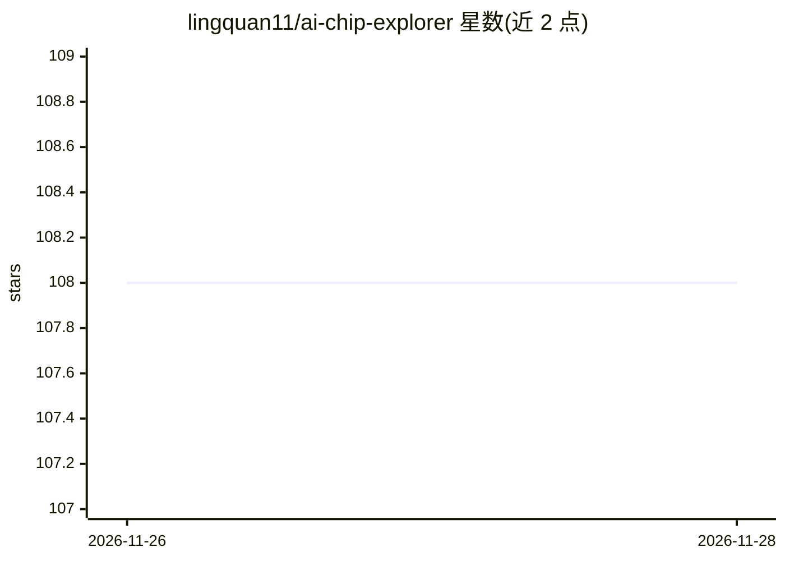

# lingquan11/ai-chip-explorer

⭐ 108 · Python · MIT · 推送 2026-11-25 · [GitHub](https://github.com/lingquan11/ai-chip-explorer) · 个人维护 · 中文 README

**AI 芯片方向初学者的对话式探索与科研构思技能**

一个面向 Codex 的 agent 技能（SKILL.md + references 资料夹），以对话伙伴形式帮助初学者：先了解背景与目标，再认识 AI 芯片各方向、做 15–30 分钟纸笔轻量任务，或围绕科研 idea 检索文献、整理 idea 卡片并设计初步验证。默认面向中国大陆大学生；也支持切换到用户自备资料的其他行业。README 明确状态为第一版草稿，安装路径与调用效果尚待实测；输出定位为探索建议而非就业预测或能力测评。

## 筛选速览

| 维度 | 判定 | 备注 |
|---|---|---|
| AI 角色 | `ai-knowledge` | 知识聚合/清单类 |
| 许可风险 | `permissive` | MIT |
| 部署形态 | `None` |  |
| 模型依赖 | — | README 未给出锁定关系 |
| 硬件要求 | — | 无带数字的原话,不猜 |
| 安装摩擦 | `low` | 无编译、无系统依赖或容器化 |
| 成熟度 | `idea` | |

## 能力要点

- 对话式方向探索：先了解背景与条件，再按用户耐受度安排轻量体验任务
- 科研 idea 流程：文献检索记录模板（含检索式、查阅时间、未验证项）、idea 卡片整理
- 首次文献检索默认不超过 3 条可核对来源，无出处断言不升级为结论
- 支持切换行业：读取用户提供的文件/链接，不硬套芯片话术

## 适用场景

- 初学者了解 AI 芯片有哪些方向并做入门体验
- 带着已有科研想法，寻找相近文献并设计小规模验证
- 完全没有 idea 时，按自身时间与设备条件获得可动手的候选问题
- 探索其他行业时结合自备资料梳理方向

## 场景标签

`科研工具` · 领域:学习与行业

## 证据(README 行号)

> L3: 为 AI 芯片方向的初学者提供一位对话伙伴：先了解你的背景和目标，再帮助你认识不同方向、尝试轻量任务，或围绕科研 idea 展开探索。默认面向中国大陆大学生；对话方法也可结合用户提供的其他行业资料使用。
> L11: - **探索科研 idea**：从零寻找候选问题，或带着已有想法来讨论、查找相关研究和设计初步验证。
> L18: 本项目优先面向 Codex；其他 agent 的兼容性尚未验证。下面是预期的用户级安装方法，**尚待在目标环境实测**：

## 星数曲线

2026-11-26 108 → 2026-11-28 108（+0）

---
*卡片 v1 · prompt 1.4 · 生成 2026-11-26 · 置信度 mid · 依据 README sha `ae0e2abcd971` · [字段定义](../../DATASET.md)*
