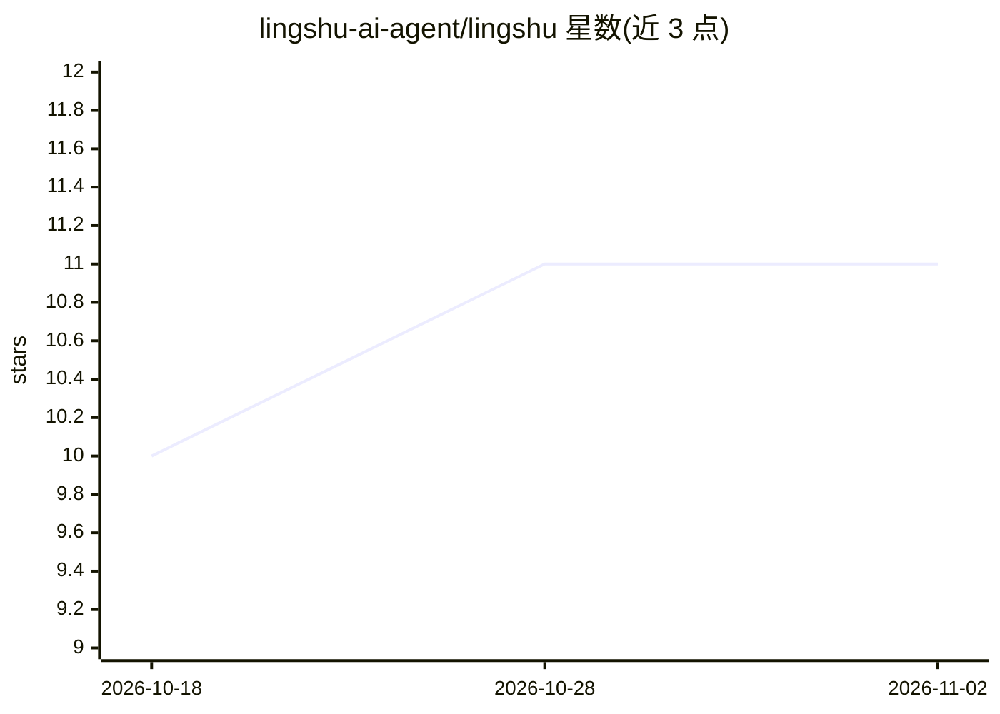

# lingshu-ai-agent/lingshu

⭐ 11 · Java · Apache-2.0 · 推送 2026-10-26 · [GitHub](https://github.com/lingshu-ai-agent/lingshu) · [官网](https://lingshu-ai-agent.github.io/lingshu-website/) · 组织维护 · 中文 README

**面向 JDK 8+ 企业 Java 栈的嵌入式 ReAct Agent 引擎**

LingShu 是用 Java 编写的 Agent 引擎，设计为嵌入 Spring Boot 进程运行，提供 ReAct Loop 执行、9 个 SPI 槽位（PromptBuilder/LlmProvider/ToolExecutor/PermissionPolicy/RuntimeSandbox/SessionStore/Compactor/FlowEngine/A2aTransport）、内置 MCP 客户端、SKILL.md 解析为 Tool、双层沙箱（权限模型 + chroot/seccomp 系统沙箱）、上下文压缩与 5 个内置工具（Read/Write/Edit/Bash/WebFetch）。面向仍在 JDK 8 LTS 且服务跑在 Spring Boot 中的企业 Java 团队，发布 v0.1.0，Apache-2.0 许可，声称 JDK 8 源码 + JDK 17+ 运行时、0 新增 Maven 依赖。通过 Maven 与 CLI 运行。

## 筛选速览

| 维度 | 判定 | 备注 |
|---|---|---|
| AI 角色 | `ai-ecosystem` | LLM/agent 周边工具 |
| 许可风险 | `permissive` | Apache-2.0 |
| 部署形态 | `None` |  |
| 模型依赖 | — | README 未给出锁定关系 |
| 硬件要求 | — | 无带数字的原话,不猜 |
| 安装摩擦 | `medium` | 含编译或系统依赖之一 |
| 成熟度 | `idea` | |

## 能力要点

- 9 个 SPI 槽位 + 14 个稳定 SPI（@PublicApi(STABLE)）
- 内置 MCP 客户端（McpToolAdapter）与 A2A AgentCard（/.well-known/agent.json）
- 双层沙箱：PermissionPolicy 三形式通配 + RuntimeSandbox（chroot/seccomp/sysbox）
- SKILL.md 多源自动发现并注册为 Tool

## 适用场景

- 在既有 Spring Boot 服务中嵌入 ReAct Agent 能力而不升级 JDK
- 通过 MCP 接入外部工具源并按权限白名单管控调用
- 以 SPI 替换 FlowEngine、Provider 等组件定制 Agent 行为

## 场景标签

`Agent 框架` · 领域:Agent 开发

## 证据(README 行号)

> L28: **灵枢**(`líng shū`,意为"针灸的关键枢轴")是 LingShu 引擎的核心仓库 —— 一个为 **JDK 8+** 企业 Java 栈设计的、生产级 **ReAct Loop Agent Engine**。
> L33: > 🟢 **We're an Engine, not an OS.**
> L35: > LingShu 不跟他们抢这条赛道:LingShu 是一个**嵌进你 Spring Boot 进程的 Engine**,

## 星数曲线

2026-10-18 10 → 2026-11-02 11（+1）

---
*卡片 v1 · prompt 1.4 · 生成 2026-11-02 · 置信度 high · 依据 README sha `60eff9efb229` · [字段定义](../../DATASET.md)*
