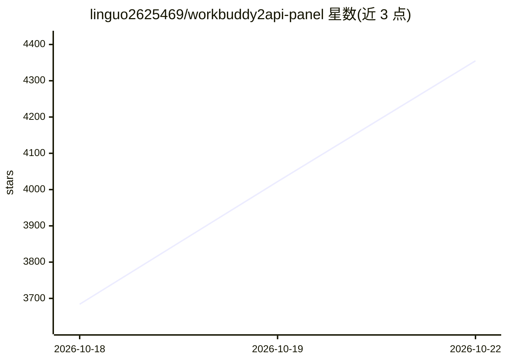

# linguo2625469/workbuddy2api-panel

⭐ 4,355 · Go · MIT · 推送 2026-10-21 · [GitHub](https://github.com/linguo2625469/workbuddy2api-panel) · 个人维护 · 中文 README

**把腾讯 CodeBuddy 账号包装为 OpenAI 兼容 API 的自托管多账号网关**

基于 Sliverkiss/workbuddy2api（上游已删库）的增强分支，Go 实现。通过 OAuth 设备授权获取腾讯 CodeBuddy 账号凭证，将其包装为统一的 /v1/chat/completions OpenAI 兼容服务：多账号池加权调度、熔断冷却、会话粘性、定时签到与保活、流式/非流式、DeepSeek 思维链注入与 reasoning_content 回填、原生工具调用标记还原。内嵌 Web 管理面板（账号池可视化、在线配置热更新、积分任务），成长任务 17/18 可纯 API 一键完成。声明仅限个人自用账号，禁止商用售卖与批量小号分发。

## 筛选速览

| 维度 | 判定 | 备注 |
|---|---|---|
| AI 角色 | `ai-ecosystem` | LLM/agent 周边工具 |
| 许可风险 | `permissive` | MIT |
| 部署形态 | `desktop` | 安装包/桌面程序 |
| 模型依赖 | — | README 未给出锁定关系 |
| 硬件要求 | — | 无带数字的原话,不猜 |
| 安装摩擦 | `low` | 无编译、无系统依赖或容器化 |
| 成熟度 | — | 结构信号不足 |

## 能力要点

- 多账号池：积分加权选号、熔断与冷却、会话粘性（可 Redis 镜像）
- 内嵌 Web 面板：账号运维、配置热更新、日志查看、积分任务
- 成长任务 17/18 纯 API 一键完成并自动领奖
- 流式/非流式输出、DeepSeek 思维链注入、tool_calls 标记还原

## 适用场景

- 给自己的本地工具提供一个 OpenAI 兼容入口，零改造接入现有 SDK
- 管理个人多个 CodeBuddy 账号：自动签到、保活、余额监控
- 单号故障自动换号与冷却熔断，维持服务可用性

## 场景标签

`模型网关` · 领域:Agent 开发

## 证据(README 行号)

> L40: WorkBuddy2API 是一个自托管的 **OpenAI 兼容反向代理网关**，将腾讯 CodeBuddy（`copilot.tencent.com`）账号包装为统一的 `/v1/chat/completions` 服务。
> L44: - 对客户端只暴露 OpenAI 兼容接口，现有 SDK / 前端 / 工具 **零改造接入**。

## 星数曲线

2026-10-18 3,684 → 2026-10-22 4,355（+671）

---
*卡片 v1 · prompt 1.4 · 生成 2026-10-20 · 置信度 mid · 依据 README sha `74d616f26751` · [字段定义](../../DATASET.md)*
