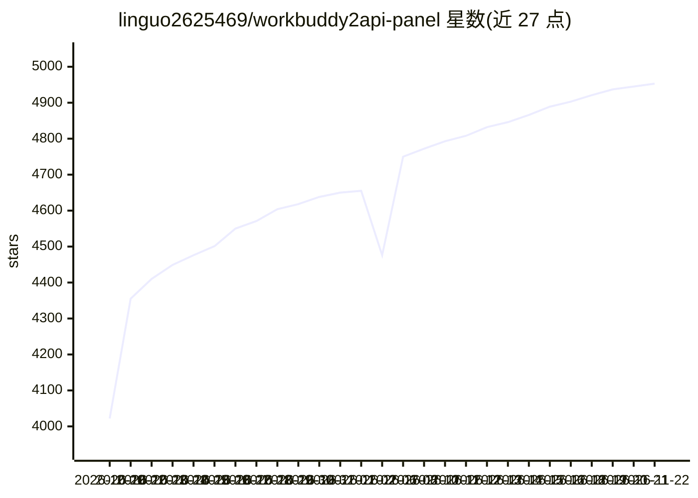

# linguo2625469/workbuddy2api-panel

⭐ 4,953 · Go · MIT · 推送 2026-10-21 · [GitHub](https://github.com/linguo2625469/workbuddy2api-panel) · 个人维护 · 中文 README

**把腾讯 CodeBuddy 账号包装为 OpenAI 兼容 API 的多账号网关，附 Web 面板**

自托管的 Go 语言 OpenAI 兼容反向代理网关（Sliverkiss/workbuddy2api 的增强分支）：通过 OAuth 设备授权接入腾讯 CodeBuddy 账号，对客户端暴露 /v1/chat/completions 接口，实现 token 自动刷新、多账号池调度（积分加权 + 成本分层 + 随机选号）、熔断与冷却、会话粘性等流量治理。分支新增内嵌 Web 管理面板（账号池可视化、热更新配置、日志）、浏览器内 OAuth 添加账号、17/18 成长任务一键自动完成与自动领奖。README 声明项目已于 2026-10-21 停止维护，仅限自用账号，禁止批量分发与转售。

## 筛选速览

| 维度 | 判定 | 备注 |
|---|---|---|
| AI 角色 | `ai-ecosystem` | LLM/agent 周边工具 |
| 许可风险 | `permissive` | MIT |
| 部署形态 | `desktop` | 安装包/桌面程序 |
| 模型依赖 | — | README 未给出锁定关系 |
| 硬件要求 | — | 无带数字的原话,不猜 |
| 安装摩擦 | `low` | 无编译、无系统依赖或容器化 |
| 成熟度 | — | 结构信号不足 |

## 能力要点

- OpenAI 兼容 /v1/chat/completions 网关，客户端零改造接入
- 多账号池调度 + 熔断/冷却 + 会话粘性 + Redis 状态镜像（可选）
- Web 面板：账号池可视化、配置热更新、任务中心、调用日志
- 17/18 官方成长任务一键纯 API 自动完成并自动领奖

## 适用场景

- 给自己的 CodeBuddy 账号提供一个 OpenAI 兼容入口接入本地工具
- 管理多个个人账号的签到、保活与积分任务
- 多账号环境下自动换号、限流冷却与日志观测

## 场景标签

`模型网关` · 领域:Agent 开发

## 证据(README 行号)

> L52: WorkBuddy2API 是一个自托管的 **OpenAI 兼容反向代理网关**，将腾讯 CodeBuddy（`copilot.tencent.com`）账号包装为统一的 `/v1/chat/completions` 服务。
> L56: - 对客户端只暴露 OpenAI 兼容接口，现有 SDK / 前端 / 工具 **零改造接入**。
> L64: |🔑 **OAuth 一键登录**|`login.sh` 设备授权流程，自动落盘凭证并重启容器加载新账号|

## 星数曲线

2026-10-20 4,022 → 2026-11-22 4,953（+931）

---
*卡片 v1 · prompt 1.4 · 生成 2026-11-22 · 置信度 high · 依据 README sha `bfb8ead323b0` · [字段定义](../../DATASET.md)*
