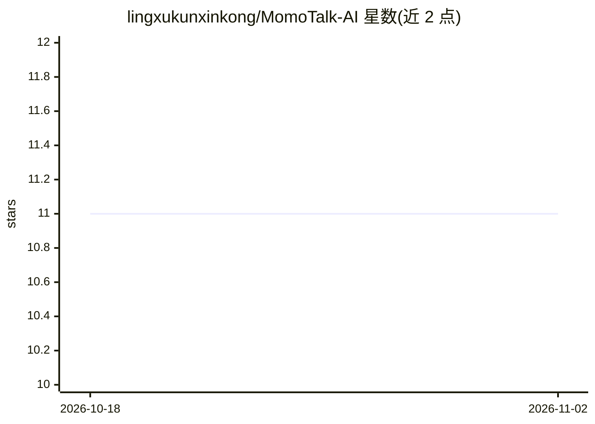

# lingxukunxinkong/MomoTalk-AI

⭐ 11 · HTML · GPL-3.0 · 推送 2026-08-20 · [GitHub](https://github.com/lingxukunxinkong/MomoTalk-AI) · [官网](https://momotalk.starsky.icu) · 个人维护 · 中文 README

**蔚蓝档案主题的多角色 AI 聊天 Web 应用，开箱即用**

基于原生 HTML5/CSS3/JavaScript 的轻量级 AI 聊天应用，界面采用 Blue Archive（蔚蓝档案）游戏角色主题色。内置 11 个预设角色，各有头像、欢迎语、系统提示词与对话风格。支持多种 AI 大模型接口（DeepSeek、Gemini、Qwen 及自定义），API 端点与密钥可配置，自带公益 API（由商汤日日新提供）。聊天记录仅存本地浏览器，支持 Markdown 渲染与深度思考展示。部署方式为下载文件后放置到 Web 服务器，或直接安装安卓 APK。

## 筛选速览

| 维度 | 判定 | 备注 |
|---|---|---|
| AI 角色 | `ai-native` | 本体是模型或模型工具 |
| 许可风险 | `viral` | GPL-3.0 |
| 部署形态 | `None` |  |
| 模型依赖 | — | README 未给出锁定关系 |
| 硬件要求 | — | 无带数字的原话,不猜 |
| 安装摩擦 | `low` | 无编译、无系统依赖或容器化 |
| 成熟度 | — | 结构信号不足 |

## 能力要点

- 内置 11 个 Blue Archive 角色预设（提示词/欢迎语/风格）
- 可配置 API 端点与密钥，自带公益 API（商汤日日新）
- 原生 HTML/CSS/JS 实现，支持 Markdown 渲染与思考过程展示
- 提供安卓 APK 与 Web 部署两种方式，聊天记录本地存储

## 适用场景

- 与预设游戏角色进行 AI 对话
- 通过自定义 API 接入 DeepSeek/Gemini/Qwen 等模型聊天
- 在手机上安装 APK 即用，无需自建服务

## 场景标签

`聊天机器人` · 领域:对话与助手

## 证据(README 行号)

> L7: MomoTalk-AI 是一款基于 Web 技术的智能聊天应用，集成了 AI 大模型对话功能，支持多种角色设定和个性化对话体验。应用采用Blue Archive（蔚蓝档案）游戏角色主题色设计，提供直观友好的用户界面。主打简约，轻量，
> L11: - **多角色对话**：内置 11 个 Blue Archive 游戏角色，每个角色拥有独特的性格和对话风格
> L12: - **智能 AI 对话**：集成多种 AI 大模型，支持自然语言处理和上下文理解

## 星数曲线

2026-10-18 11 → 2026-11-02 11（+0）

---
*卡片 v1 · prompt 1.4 · 生成 2026-11-02 · 置信度 high · 依据 README sha `07d325447eaf` · [字段定义](../../DATASET.md)*
