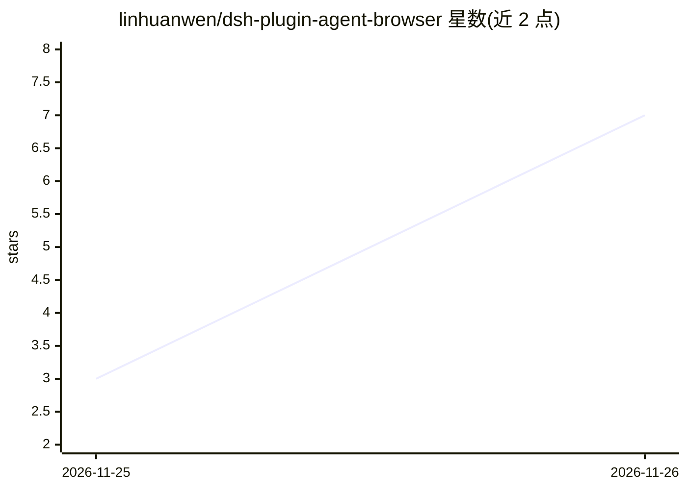

# linhuanwen/dsh-plugin-agent-browser

⭐ 7 · JavaScript · MIT · 推送 2026-11-24 · [GitHub](https://github.com/linhuanwen/dsh-plugin-agent-browser) · 个人维护 · 中文 README

**给 DeepSeek Harness 桌面端加一个 Agent 可操作的真浏览器侧栏插件**

DSH Desktop 插件，在右侧栏渲染 Electron `<webview>` 浏览器面板，向对话中的 Agent 暴露 11 个 browser_* 工具（打开/快照/点击/输入/截图/下载等）。快照输出带 `[ref=eN]` 的无障碍树供模型按引用操作；检测到 Cloudflare、reCAPTCHA 等验证页时停下并把控制权交还用户，支持「我来接管/交还 Agent」双向交接。仅支持 DSH Desktop 的 Windows/macOS 桌面端，一个 profile 只能启用一个浏览器后端。纯 JS 无构建步骤，附 196 个单测。

## 筛选速览

| 维度 | 判定 | 备注 |
|---|---|---|
| AI 角色 | `ai-ecosystem` | LLM/agent 周边工具 |
| 许可风险 | `permissive` | MIT |
| 部署形态 | `None` |  |
| 模型依赖 | locked-api |  |
| 硬件要求 | — | 无带数字的原话,不猜 |
| 安装摩擦 | `low` | 无编译、无系统依赖或容器化 |
| 成熟度 | — | 结构信号不足 |

## 能力要点

- 11 个 browser_* 工具操作带登录态的真 webview 浏览器
- 快照带 [ref=eN] 可寻址元素，无需猜坐标
- 人机验证检测与接管交接，密码框拒绝输入
- 截图与下载带 sha256，13 个稳定错误码

## 适用场景

- 让 Agent 按筛选条件登录后台整理订单或账单为表格
- 抓取需 JS 渲染或登录后才能看到的页面内容
- 需要整页截图与下载文件作为留证的场景
- 遇到验证码时人工接手后让 Agent 继续跑

## 场景标签

`浏览器自动化` · 领域:效率与自动化

## 证据(README 行号)

> L5: **在 DeepSeek Harness 的右侧栏里，让 Agent 用你的真浏览器干活：它看得见、点得动，你随时可以接管。**
> L83: |宿主|**仅 DSH Desktop（Electron）**。面板依赖 `<webview>` 与 `globalThis.dshDesktop.browser` 租约，Web 版没有这两样|
> L20: DSH 桌面端本来就能开网页：你点开、你操作。这个插件补的不是"又一个浏览器"，而是**让 Agent 能用同一块面板**——它看得到带 `ref` 的元素、点得动、填得进、能把文件带回来，中间还能把鼠标交还给你。

## 星数曲线

2026-11-25 3 → 2026-11-26 7（+4）

---
*卡片 v1 · prompt 1.4 · 生成 2026-11-24 · 置信度 high · 依据 README sha `df57fdf58342` · [字段定义](../../DATASET.md)*
