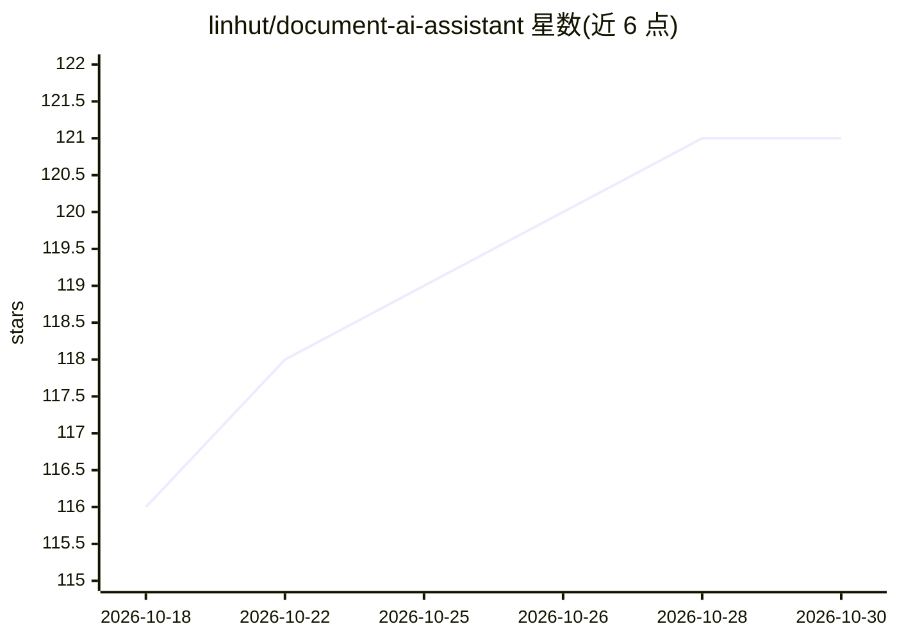

# linhut/document-ai-assistant

⭐ 121 · Python · MIT · 推送 2026-09-26 · [GitHub](https://github.com/linhut/document-ai-assistant) · [官网](https://doc.linhut.cn) · 个人维护 · 中文 README

**按 GB/T 9704 标准检测并优化中文公文格式的桌面应用**

面向公文写作场景的桌面应用（Electron + React 前端、FastAPI Python 后端）：依据 GB/T 9704-2012 标准对 22 种法定文种做格式检查（每文种 38-41 条规则，关联标准条款证据链）与一键自动修复（34 条修复规则），生成优化后的 .docx。支持文号、成文日期等要素语义校验，可接入 23+ AI 服务商做语义级深度分析，支持 A4 实时预览与 Markdown 转公文。数据本地运行，API Key 加密存储；AI 功能需配置服务商 API 或本地 Ollama。提供 Windows 一键启动、源码运行及信创系统（UOS/银河麒麟/OpenEuler/龙芯等）部署指南，另有可被 Claude Code 调用的 gongwen-skill 独立发行版。

## 筛选速览

| 维度 | 判定 | 备注 |
|---|---|---|
| AI 角色 | `ai-enhanced` | 去掉 AI 部分产品仍成立 |
| 许可风险 | `permissive` | MIT |
| 部署形态 | `library` | 以包/库形式分发 |
| 模型依赖 | local-ok | 支持本地模型 |
| 硬件要求 | — | 无带数字的原话,不猜 |
| 安装摩擦 | `medium` | 含编译或系统依赖之一 |
| 成熟度 | — | 结构信号不足 |

## 能力要点

- 按 GB/T 9704-2012 对 22 种文种做格式检查与自动修复，规则关联标准条款证据链
- 接入 23+ AI 服务商（DeepSeek/通义千问/Ollama/OpenRouter 等）做语义级分析
- A4 实时预览、Markdown 转公文、.doc/.wps 自动转换
- 支持信创系统部署与 gongwen-skill 命令行 Skill 发行版

## 适用场景

- 检查并修复公文格式，使其符合 GB/T 9704 标准
- 用 AI 深度分析发现规则引擎无法识别的语义问题
- 将 Markdown 草稿转换为标准公文格式

## 场景标签

`AI 写作` · 领域:内容生成

## 证据(README 行号)

> L62: - **格式检测** — 依据 GB/T 9704 标准自动检查公文格式（字体、字号、缩进、行距、页边距等），每个文种生效 38–41 条检查规则（公共基础层 + 文种层三层合并）
> L66: - **AI 深度分析** — 接入大模型进行语义级分析，按 22 种文种定制检查规则，发现规则引擎无法识别的问题

## 星数曲线

2026-10-18 116 → 2026-10-30 121（+5）

---
*卡片 v1 · prompt 1.4 · 生成 2026-10-23 · 置信度 mid · 依据 README sha `88e24aea0877` · [字段定义](../../DATASET.md)*
