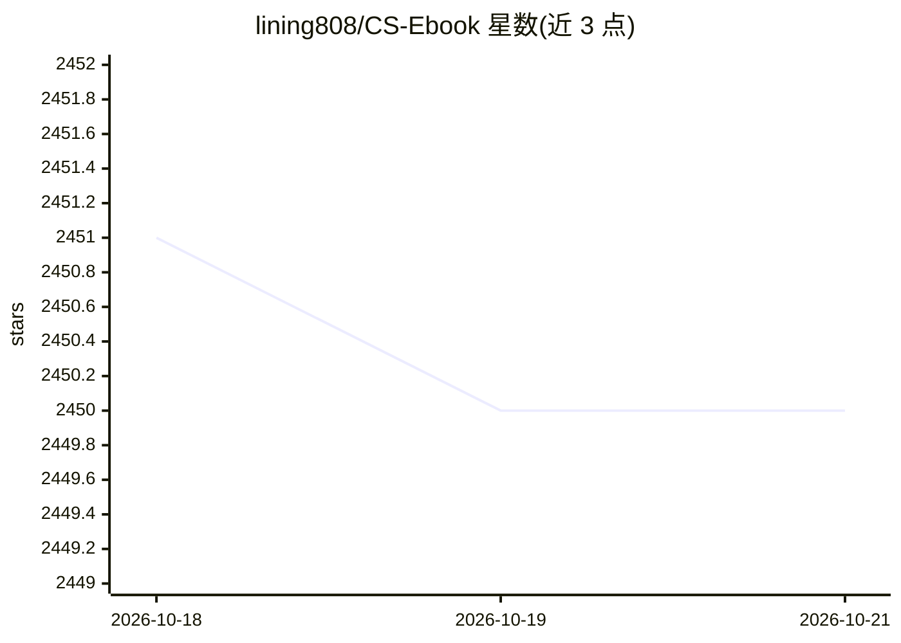

# lining808/CS-Ebook

⭐ 2,450 · Python · 推送 2025-10-24 · [GitHub](https://github.com/lining808/CS-Ebook) · 个人维护 · 中文 README

**计算机各方向经典书籍的中文推荐书单清单**

个人维护的计算机科学与技术书籍推荐清单，覆盖计算机基础、编程语言（C/C++/Java/Python/Go/Rust 等）、软件工程、数学、大数据、人工智能（图像处理、强化学习、机器学习、深度学习、NLP）、软考与面试等方向，以表格形式按子类组织书名。声明只收录各方向经典书籍、保持最新版本，不提供下载地址，建议读者自行通过 Z-Library 检索、网络搜索或购买纸质书。维护者自述为 AI 算法方向，Python/C++/人工智能类收录更全，接受网友 PR 补充。

## 筛选速览

| 维度 | 判定 | 备注 |
|---|---|---|
| AI 角色 | `ai-knowledge` | 知识聚合/清单类 |
| 许可风险 | `none` | — |
| 部署形态 | `None` |  |
| 模型依赖 | — | README 未给出锁定关系 |
| 硬件要求 | — | 无带数字的原话,不猜 |
| 安装摩擦 | `low` | 无编译、无系统依赖或容器化 |
| 成熟度 | — | 结构信号不足 |

## 能力要点

- 按计算机基础、编程语言、软件工程、数学、AI、大数据等大类及子类组织书单
- 声明只收各方向经典书籍并保持更新
- 不提供下载地址，仅作推荐，支持 PR 收录补充

## 适用场景

- 按方向查找经典书籍规划学习路线
- 准备软考或程序员面试时查找参考书
- 了解 AI、深度学习方向的常见书籍

## 场景标签

`精选清单` · 领域:学习与行业

## 证据(README 行号)

> L1: 本储存库是一些高质量的计算机科学与技术书籍推荐书单，需要学习的可以按照此书单进行学习进阶，包含了计算机大多数软件相关方向。而且敢承诺一直更新。
> L35: * 推荐的书籍，不提供下载地址，需要的可以通过 Z-Library(全球最大的开源图书馆) 检索下载，上面书籍较多。

## 星数曲线

2026-10-18 2,451 → 2026-10-21 2,450（-1）

---
*卡片 v1 · prompt 1.4 · 生成 2026-10-21 · 置信度 high · 依据 README sha `2131d668f98d` · [字段定义](../../DATASET.md)*
