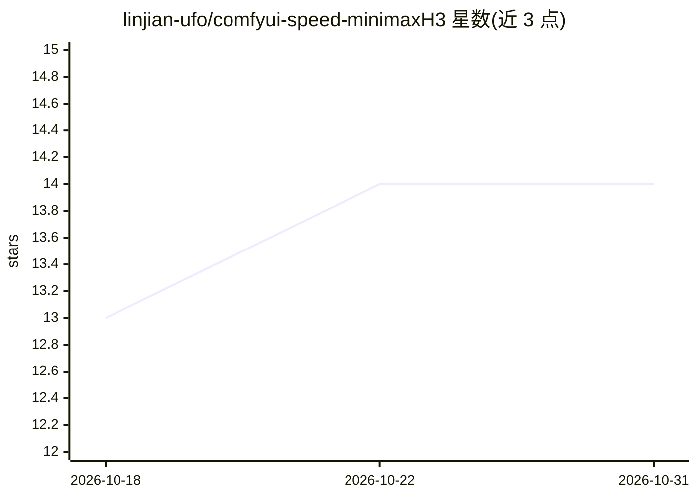

# linjian-ufo/comfyui-speed-minimaxH3

⭐ 14 · Python · GPL-3.0 · 推送 2026-10-02 · [GitHub](https://github.com/linjian-ufo/comfyui-speed-minimaxH3) · 个人维护 · 中文 README

**MiniMax H3 视频生成专用的 ComfyUI 残差缓存加速节点**

面向使用 ComfyUI 运行 MiniMax H3 视频生成的工作流开发者的自定义节点。核心机制：在相邻采样步骤变化较小时复用整段 Transformer 残差（跳步），自动检测并启用 SageAttention，不可用时回退默认后端；另提供文本编码缓存（相同提示词/参考图复用 CPU 缓存）、显存/内存预算自动选择 GPU/CPU 缓存、重复 sigma 隔离与缓存冲突检测。附带 linjian Image to Video 子图与 Reference to Video 节点。仅支持 MiniMaxH3Model，不支持其他模型；通过 git clone 到 custom_nodes 安装。

## 筛选速览

| 维度 | 判定 | 备注 |
|---|---|---|
| AI 角色 | `ai-ecosystem` | LLM/agent 周边工具 |
| 许可风险 | `viral` | GPL-3.0 |
| 部署形态 | `None` |  |
| 模型依赖 | — | README 未给出锁定关系 |
| 硬件要求 | — | 无带数字的原话,不猜 |
| 安装摩擦 | `medium` | 含编译或系统依赖之一 |
| 成熟度 | — | 结构信号不足 |

## 能力要点

- 相邻步骤变化小时复用 Transformer 残差，支持复用阈值、加速区间与最大连续跳步参数
- sage_attention=auto 自动检测启用 SageAttention，不兼容时安全回退
- 完全相同的提示词/参考图/编码参数复用 32B 文本编码器 CPU 缓存
- auto 按显存/内存预算选择 GPU/CPU 缓存，CUDA 分配失败可转 CPU 路径

## 适用场景

- 加速 ComfyUI 中 MiniMax H3 图生视频/参考生视频的采样
- 重复运行相同提示词与参考图时减少文本编码耗时
- 显存有限时通过 CPU 缓存路径降低 OOM 概率

## 场景标签

`视频生成` `推理引擎` · 领域:内容生成

## 证据(README 行号)

> L5: MiniMax H3 专用的 ComfyUI 安全加速节点。它默认自动为扩散模型启用 SageAttention，在相邻采样步骤变化较小时复用整段 Transformer 残差，并可缓存完全相同的提示词与参考图编码结果；同时提供显存
> L18: - 为 `MiniMaxH3Model` 提供专用注意力覆盖，不需要再额外串联第三方 SageAttention 节点。
> L131: 2. 将模型加载节点的 `MODEL` 输出连接到本节点的 `model` 输入。

## 星数曲线

2026-10-18 13 → 2026-10-31 14（+1）

---
*卡片 v1 · prompt 1.4 · 生成 2026-10-31 · 置信度 high · 依据 README sha `c1ebb2a5d47b` · [字段定义](../../DATASET.md)*
