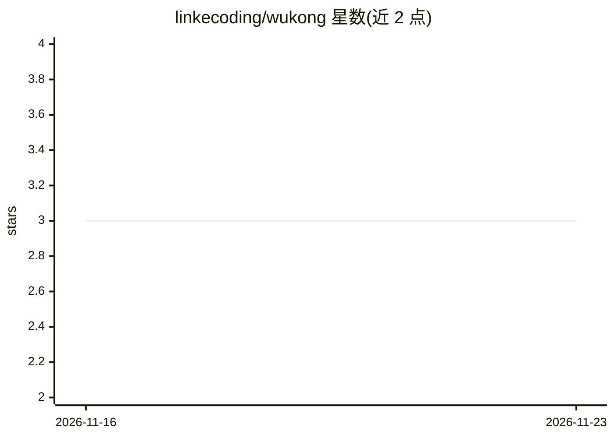

# linkecoding/wukong

⭐ 3 · Kotlin · 推送 2026-11-16 · [GitHub](https://github.com/linkecoding/wukong) · 个人维护 · 中文 README

**安卓个人 AI 代理：自然语言跨应用执行手机操作**

面向 Android 的个人 AI 代理，将自然语言目标转为跨应用动作：启动应用、读取 UI 元素、输入、滑动与点击，配合端侧 OCR 与截图理解。通过内置无线 ADB 授权启动 app_process shell 执行，无需 root 或无障碍服务；支持虚拟显示运行与人工接管。模型由用户自备，接入 Chat Completions 兼容端点，端内嵌 QuickJS 支持模型编写工作流。当前为 v0.0.2 Early preview，仅在 Pixel 6 上完成核心流程测试；许可尚未选定。

## 筛选速览

| 维度 | 判定 | 备注 |
|---|---|---|
| AI 角色 | `ai-native` | 本体是模型或模型工具 |
| 许可风险 | `none` | — |
| 部署形态 | `None` |  |
| 模型依赖 | locked-api |  |
| 硬件要求 | — | 无带数字的原话,不猜 |
| 安装摩擦 | `high` | 编译与系统依赖俱全 |
| 成熟度 | `idea` | |

## 能力要点

- 内置无线 ADB 配对与 app_process 执行引擎，无需 root/无障碍服务
- 端侧 PP-OCR tiny OCR，模型推理走用户自配的 Chat Completions 端点
- 内嵌 QuickJS 运行时，模型可编写循环/条件/UI 监听的 JS 工作流
- 虚拟显示悬浮预览与手动接管，支付/删除等敏感操作需本地确认

## 适用场景

- 用一句话让手机跨应用完成查文件、设闹钟等任务
- 在虚拟显示中观察代理执行并随时人工接管
- 自带 API key 接入自选模型驱动手机自动化

## 场景标签

`GUI 自动化` · 领域:效率与自动化

## 证据(README 行号)

> L7: **Wukong** is a personal AI agent for Android that turns a natural-language goal into actions across your phone, wit
> L43: 2. Tap Send; if setup is incomplete, the guided setup opens. Select DeepSeek, Alibaba Cloud / Qwen, Zhipu / GLM, Mo
> L65: Your configured model proposes actions; Wukong validates and executes them through its local shell engine. QuickJS 

## 星数曲线

2026-11-16 3 → 2026-11-23 3（+0）

---
*卡片 v1 · prompt 1.4 · 生成 2026-11-21 · 置信度 high · 依据 README sha `e0d34365f85c` · [字段定义](../../DATASET.md)*
