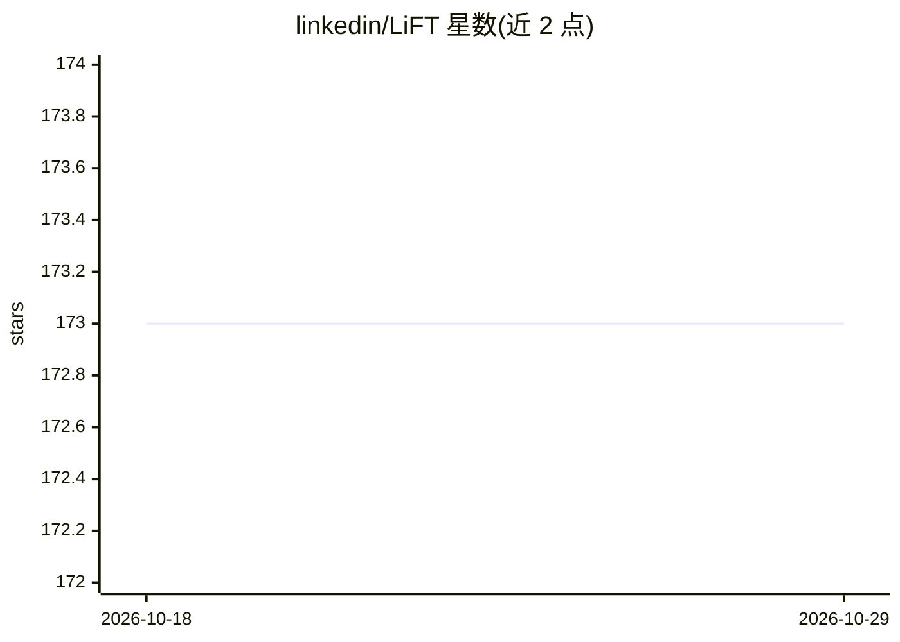

# linkedin/LiFT

⭐ 173 · Scala · BSD-2-Clause · 推送 2025-12-19 · [GitHub](https://github.com/linkedin/LiFT) · 组织维护

**面向大规模 ML 工作流的公平性测量与偏差缓解库**

LinkedIn 开源的 Scala/Spark 库，用于在大规模机器学习工作流中测量公平性与缓解偏差。测量模块支持测量训练数据偏差、评估模型公平性指标、通过置换检验检测不同子群间模型性能的统计显著性差异；缓解模块提供后处理方法，将模型分数转换为满足排序场景机会均等（可处理位置偏差），无需改动现有模型训练流程。提供配置驱动的 Spark 作业与多层级 API，通过 Gradle 构建为 JAR，经 Maven Central / Artifactory 以依赖方式接入，推荐 Scala 2.11.8 与 Spark 2.3.0（可指定 2.4/2.12 组合）。

## 筛选速览

| 维度 | 判定 | 备注 |
|---|---|---|
| AI 角色 | `ai-ecosystem` | LLM/agent 周边工具 |
| 许可风险 | `permissive` | BSD-2-Clause |
| 部署形态 | `None` |  |
| 模型依赖 | — | README 未给出锁定关系 |
| 硬件要求 | — | 无带数字的原话,不猜 |
| 安装摩擦 | `low` | 无编译、无系统依赖或容器化 |
| 成熟度 | — | 结构信号不足 |

## 能力要点

- 训练数据与模型性能两方向的公平性指标测量
- 置换检验框架检测子群间模型性能的统计显著性差异
- 后处理实现排序场景的机会均等（支持位置偏差校正），不改动模型训练管线
- 配置驱动 Spark 作业 + UDF 自定义指标，多层级 API 便于集成 ML 管线与 Jupyter

## 适用场景

- 在大规模 Spark 数据管道中定期测量训练数据的公平性指标
- 评估并检验模型在不同子群上的性能差异是否统计显著
- 对排序模型分数做后处理以满足机会均等约束

## 场景标签

 · 领域:机器学习公平性/大数据

## 证据(README 行号)

> L11: The LinkedIn Fairness Toolkit (LiFT) is a Scala/Spark library that enables the measurement of fairness and the miti
> L32: LiFT provides a configuration-driven Spark job for scheduled deployments, with support for custom metrics through

## 星数曲线

2026-10-18 173 → 2026-10-29 173（+0）

---
*卡片 v1 · prompt 1.4 · 生成 2026-10-22 · 置信度 high · 依据 README sha `d555474c5126` · [字段定义](../../DATASET.md)*
