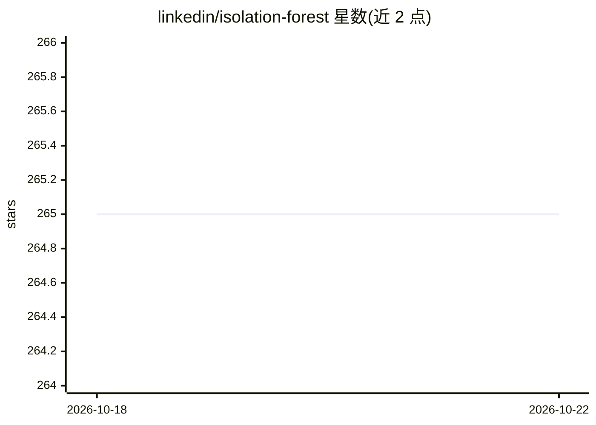

# linkedin/isolation-forest

⭐ 265 · Scala · NOASSERTION · 推送 2026-08-04 · [GitHub](https://github.com/linkedin/isolation-forest) · 组织维护

**给数据工程师的 Spark/Scala 分布式孤立森林异常检测库**

LinkedIn 反滥用 AI 团队维护的 Scala/Spark 实现，提供标准孤立森林与扩展孤立森林（随机超平面切分）两种无监督离群点检测算法。核心模块继承 Spark ML 的 Estimator/Model，支持分布式训练评分、Pipeline 集成与模型 HDFS 持久化；isolation-forest-onnx 子模块以 pip 安装的 Python 转换器将标准模型导出为 ONNX 跨平台推理（扩展版本不兼容）。通过 Maven Central 或 Gradle 引入，默认 Scala 2.13.14 / Spark 3.5.5。

## 筛选速览

| 维度 | 判定 | 备注 |
|---|---|---|
| AI 角色 | `ai-native` | 本体是模型或模型工具 |
| 许可风险 | `none` | NOASSERTION |
| 部署形态 | `library` | 以包/库形式分发 |
| 模型依赖 | — | README 未给出锁定关系 |
| 硬件要求 | — | 无带数字的原话,不猜 |
| 安装摩擦 | `low` | 无编译、无系统依赖或容器化 |
| 成熟度 | — | 结构信号不足 |

## 能力要点

- 分布式训练与评分，继承 Spark ML Estimator/Model，支持 Pipeline 与 HDFS 模型持久化
- Extended Isolation Forest 用随机超平面切分消除轴对齐偏置，适合相关特征数据
- ONNX 导出转换器（isolation-forest-onnx，pip 安装）实现跨平台推理，仅支持标准 IF
- 可指定任意 Spark/Scala 版本组合构建

## 适用场景

- 在 Spark 集群上对大规模数据做无监督异常检测
- 处理特征相关、异常不沿单轴分布的数据时使用扩展孤立森林
- 将训练好的异常检测模型导出 ONNX 在其他平台推理

## 场景标签

 · 领域:机器学习/异常检测

## 证据(README 行号)

> L12: This is a distributed Scala/Spark implementation of the Isolation Forest unsupervised outlier detection
> L21: * **Distributed training and scoring:** The `isolation-forest` module supports distributed training and scoring in 

## 星数曲线

2026-10-18 265 → 2026-10-22 265（+0）

---
*卡片 v1 · prompt 1.4 · 生成 2026-10-22 · 置信度 high · 依据 README sha `ccb16218ac69` · [字段定义](../../DATASET.md)*
