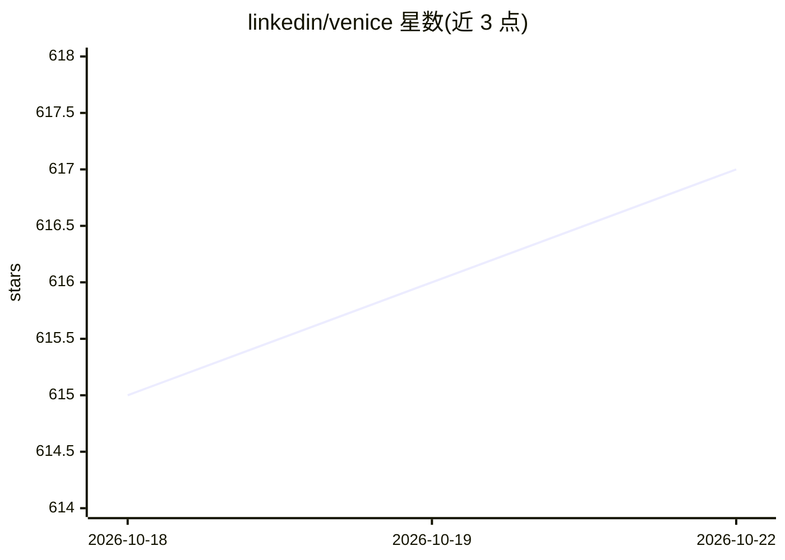

# linkedin/venice

⭐ 617 · Java · BSD-2-Clause · 推送 2026-10-20 · [GitHub](https://github.com/linkedin/venice) · [官网](https://venicedb.org) · 组织维护

**面向在线推断的衍生数据存储平台，支撑特征存储**

LinkedIn 开源的衍生数据存储平台：从批处理（Hadoop/Spark）与流式（Samza/Online Producer）来源高吞吐异步写入，提供单点/批量读取与读计算（点积、余弦相似度），以及 Thin/Fast/DaVinci 三种客户端选项；支持跨区域 active-active 复制（CRDT 冲突解决）、多集群与多租户。定位为特征存储（如 Feathr）的有状态后端：ML 训练作业输出写入 Venice，在线推断时查询。依赖以 Gradle/Maven 添加，未发布到 Maven Central，需附加仓库定义。

## 筛选速览

| 维度 | 判定 | 备注 |
|---|---|---|
| AI 角色 | `ai-ecosystem` | LLM/agent 周边工具 |
| 许可风险 | `permissive` | BSD-2-Clause |
| 部署形态 | `None` |  |
| 模型依赖 | — | README 未给出锁定关系 |
| 硬件要求 | — | 无带数字的原话,不猜 |
| 安装摩擦 | `low` | 无编译、无系统依赖或容器化 |
| 成熟度 | — | 结构信号不足 |

## 能力要点

- 批处理/流式高吞吐异步写入与混合存储
- 三种读取客户端（Thin/Fast/DaVinci，延迟 <10ms/<2ms/<1ms）
- CRDT 冲突解决的跨区域 active-active 复制
- 服务端读计算：点积、余弦相似度、字段投影

## 适用场景

- 作为特征存储的后端支撑在线推断查询
- ML 训练产出数据后供低延迟在线读取
- 跨区域多活部署的数据存储层

## 场景标签

 · 领域:数据基础设施/ML 特征服务

## 证据(README 行号)

> L27: The above makes Venice particularly suitable as the stateful component backing a Feature Store, such as
> L28: Feathr. AI applications feed the output of their ML training jobs into Venice and

## 星数曲线

2026-10-18 615 → 2026-10-22 617（+2）

---
*卡片 v1 · prompt 1.4 · 生成 2026-10-21 · 置信度 high · 依据 README sha `7fca7c5e14bf` · [字段定义](../../DATASET.md)*
