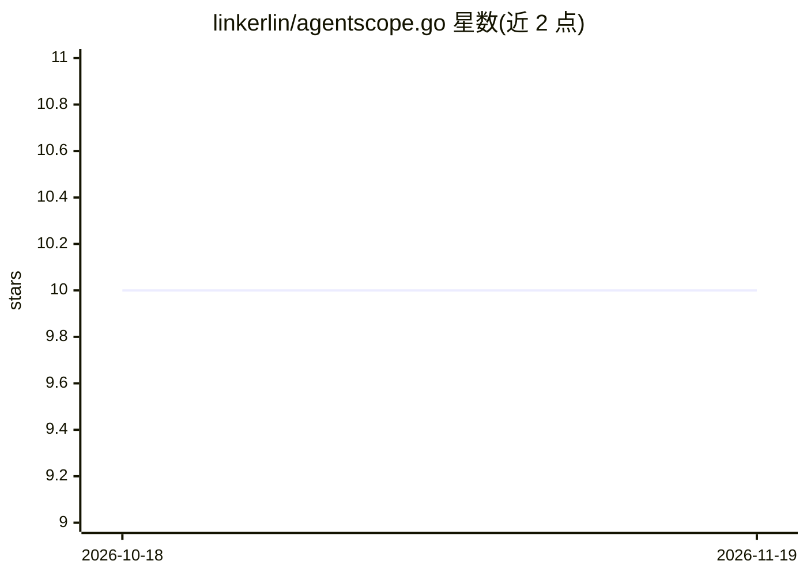

# linkerlin/agentscope.go

⭐ 10 · Go · Apache-2.0 · 推送 2026-11-08 · [GitHub](https://github.com/linkerlin/agentscope.go) · [官网](https://zhichai.net/) · 个人维护 · 中文 README

**Go 语言的 LLM Agent 开发框架，覆盖工具/记忆/编排/网关**

以 Go 语言实现的 Agent 开发框架（当前发行号 v2.7.0），采用 ReAct 范式组织模型调用与工具执行；包结构覆盖消息、模型接入、记忆（含向量与长期记忆）、工具、多 Agent 编排（Pipeline/MsgHub/Workflow）、RAG 管道、A2A 协议、HTTP/SSE/WebSocket Gateway、治理平面与插件加载。要求 Go 1.25+，通过 go get 安装；Workspace 沙箱可接 Docker/E2B/K8s 等执行环境；模型通过 OpenAI 兼容格式或各家原生协议接入，另有终端 TUI 调试工具。

## 筛选速览

| 维度 | 判定 | 备注 |
|---|---|---|
| AI 角色 | `ai-ecosystem` | LLM/agent 周边工具 |
| 许可风险 | `permissive` | Apache-2.0 |
| 部署形态 | `None` |  |
| 模型依赖 | local-ok | 支持本地模型 |
| 硬件要求 | — | 无带数字的原话,不猜 |
| 安装摩擦 | `low` | 无编译、无系统依赖或容器化 |
| 成熟度 | — | 结构信号不足 |

## 能力要点

- ReAct Agent 实现与 Hook、流式事件、Usage 统计
- 多 Agent 编排：Pipeline/Parallel/MsgHub/条件循环/MapReduce
- 记忆系统含 5 实现、7 向量后端与 Hybrid Search(BM25+Reranker)
- Gateway 支持 HTTP/SSE/WebSocket，多租户认证与 Session 持久化

## 适用场景

- 在 Go 项目中构建基于大语言模型的 Agent 应用
- 搭建多 Agent 协作流水线（审稿、MapReduce 等）
- 为 Agent 提供带网关与多租户的对外服务接口
- 通过本地 Ollama/vLLM 后端做私有化部署

## 场景标签

`Agent 框架` `多智能体` `Agent 记忆` `RAG` · 领域:Agent 开发

## 证据(README 行号)

> L3: AgentScope.Go —— 一个生产级的 AI Agent 开发框架，助你使用 Go 构建基于大语言模型的智能应用。
> L9: AgentScope.Go 提供了构建智能 Agent 所需的一切，采用 ReAct（推理 + 行动）范式：工具调用、记忆管理、多 Agent 协作、**终端 TUI**、**长时序治理平面**、**多平台聊天机器人（Webhook

## 星数曲线

2026-10-18 10 → 2026-11-19 10（+0）

---
*卡片 v1 · prompt 1.4 · 生成 2026-11-19 · 置信度 high · 依据 README sha `9d9e68f0b19c` · [字段定义](../../DATASET.md)*
