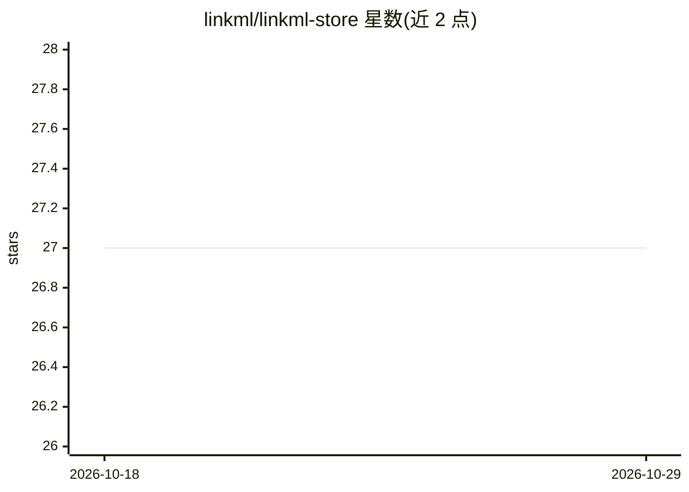

# linkml/linkml-store

⭐ 27 · Python · MIT · 推送 2026-10-09 · [GitHub](https://github.com/linkml/linkml-store) · [官网](https://linkml.io/linkml-store) · 组织维护

**多后端数据管理与集成平台，提供统一查询、索引与 RAG 能力**

LinkML 维护的数据管理抽象层，封装 DuckDB、MongoDB、Neo4j、Solr、Ibis（覆盖 PostgreSQL/SQLite/BigQuery/Snowflake 等）及本地文件系统等多种后端，提供统一 CRUDSI（增删改查+搜索+推理）操作：关键词与 LLM 向量嵌入语义搜索（无需专用向量数据库）、基于 LinkML 的结构/语义校验、RAG 与规则推理。提供 CLI、Python API、FastAPI Web API 与 Streamlit 应用。README 声明 API 与命令行选项仍在变动中。

## 筛选速览

| 维度 | 判定 | 备注 |
|---|---|---|
| AI 角色 | `ai-ecosystem` | LLM/agent 周边工具 |
| 许可风险 | `permissive` | MIT |
| 部署形态 | `library` | 以包/库形式分发 |
| 模型依赖 | — | README 未给出锁定关系 |
| 硬件要求 | — | 无带数字的原话,不猜 |
| 安装摩擦 | `low` | 无编译、无系统依赖或容器化 |
| 成熟度 | `idea` | |

## 能力要点

- 多后端适配层：MongoDB/DuckDB/Solr/Neo4j/Ibis/文件系统
- CRUDSI 模式：搜索与推理（RAG、规则、统计 ML）纳入数据操作
- LLM 向量嵌入语义搜索，无需专用向量数据库
- 基于 LinkML 的结构性与语义约束校验

## 适用场景

- 跨多种数据库后端做统一的数据存取与查询
- 在不部署向量数据库的情况下给数据加语义搜索
- 利用 LinkML schema 对 JSON 数据做校验与缺失数据推理
- 通过 CLI/Python/Web API 构建数据驱动的应用

## 场景标签

`RAG` `语义搜索` · 领域:知识与检索

## 证据(README 行号)

> L3: An AI-ready data management and integration platform. LinkML-Store
> L79:  * Inference using LLM Retrieval Augmented Generation (RAG)
> L75:  * Search using LLM Vector embeddings (*without* a dedicated vector database)

## 星数曲线

2026-10-18 27 → 2026-10-29 27（+0）

---
*卡片 v1 · prompt 1.4 · 生成 2026-10-26 · 置信度 low · 依据 README sha `334f4df95870` · [字段定义](../../DATASET.md)*
