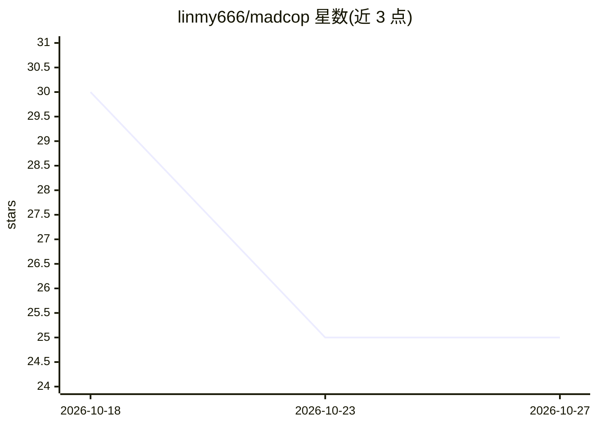

# linmy666/madcop

⭐ 25 · Python · NOASSERTION · 推送 2026-09-10 · [GitHub](https://github.com/linmy666/madcop) · 个人维护 · 中文 README

**本地优先的桌面 AI agent 工作站，数据留在本机**

由个人开发者林芮翰开发的 Electron + Vue 3 + FastAPI 跨平台桌面应用，将 LLM 接入私有 agent 工作流：可连接任意 OpenAI 兼容 API 端点，无默认硬编码模型。内置四个工作流系统：带引用的联网长文生成管线、后台监视文件变更与终端输出的主动观察器、知识图谱画布、以及将长对话自动蒸馏为可复用 SKILL.md 文件的机制。支持四档模式路由（快速/标准 ReAct/深度多 agent DAG），工具系统含内置工具、MCP 服务器接入与用户自定义 Python 工具。对话、文件与知识库全部存于本机 ~/.madcop/ 目录。

## 筛选速览

| 维度 | 判定 | 备注 |
|---|---|---|
| AI 角色 | `ai-native` | 本体是模型或模型工具 |
| 许可风险 | `none` | NOASSERTION |
| 部署形态 | `library` | 以包/库形式分发 |
| 模型依赖 | — | README 未给出锁定关系 |
| 硬件要求 | — | 无带数字的原话,不猜 |
| 安装摩擦 | `low` | 无编译、无系统依赖或容器化 |
| 成熟度 | — | 结构信号不足 |

## 能力要点

- 连接任意 OpenAI 兼容端点，模型配置存于用户数据而非产品内
- planner→fetcher→outliner→writer 的带引用长文生成管线
- 后台观察器监视文件变更与终端回滚，经小型 LLM 判决后提示
- 长对话自动蒸馏为 ~/.madcop/skills/ 下的可复用 SKILL.md
- 支持 MCP 服务器注册与 @tool 装饰器自定义工具

## 适用场景

- 在本地完成搜索、读文件、写报告的多步 LLM 任务而不上传数据
- 让 agent 在我指定的工作目录中读写代码与生成文档
- 把日常与 AI 的长对话沉淀为可复用技能文件
- 通过 MCP 与自定义 Python 工具接入私有 API 或数据库

## 场景标签

`多智能体` `知识图谱` `AI 写作` · 领域:Agent 开发

## 证据(README 行号)

> L5: MadCop is a cross-platform desktop application that brings the power of modern LLMs into a private, agentic workflow
> L17: MadCop is an Electron + Vue 3 + FastAPI desktop agent that ships four integrated workflow systems end-to-end:
> L20: - **Proactive observer** — watches file changes and terminal scrollback in the background, routes observations thro

## 星数曲线

2026-10-18 30 → 2026-10-27 25（-5）

---
*卡片 v1 · prompt 1.4 · 生成 2026-10-27 · 置信度 mid · 依据 README sha `31eb713bf27b` · [字段定义](../../DATASET.md)*
