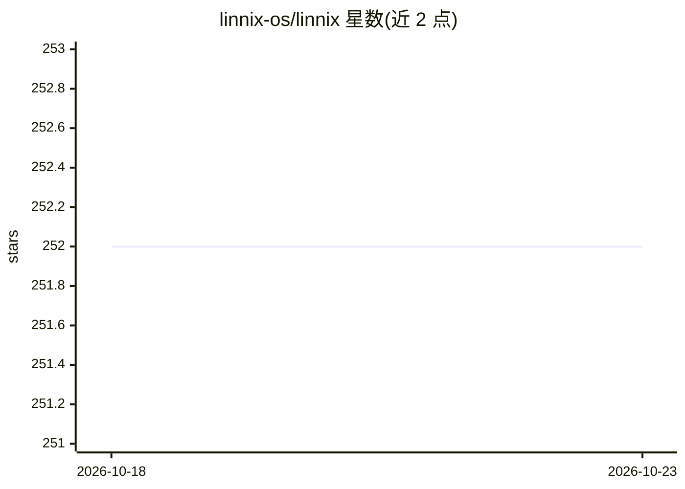

# linnix-os/linnix

⭐ 252 · Rust · NOASSERTION · 推送 2026-09-19 · [GitHub](https://github.com/linnix-os/linnix) · 组织维护

**eBPF+PSI 的 Kubernetes 可观测性工具：定位哪个进程在拖慢谁**

基于 eBPF 与 PSI（Pressure Stall Information）的 Linux 可观测性工具，面向 Kubernetes 运维场景：测量实际停滞时间而非使用率，输出 pod 间加害/受害配对的归因指标（Prometheus counter），并检测噪音邻居、Fork 风暴、内存泄漏等事件。提供 kubectl DaemonSet 部署、Docker 快速脚本、CLI 事后调查命令与 MCP 服务供 AI agent 调用。AI 洞察模型为可选且默认关闭（首次运行下载 2.1GB 本地模型）。默认仅监控不执行动作，分析在本地完成。

## 筛选速览

| 维度 | 判定 | 备注 |
|---|---|---|
| AI 角色 | `ai-enhanced` | 去掉 AI 部分产品仍成立 |
| 许可风险 | `none` | NOASSERTION |
| 部署形态 | `None` |  |
| 模型依赖 | — | README 未给出锁定关系 |
| 硬件要求 | — | 无带数字的原话,不猜 |
| 安装摩擦 | `low` | 无编译、无系统依赖或容器化 |
| 成熟度 | `idea` | |

## 能力要点

- eBPF 采集 fork/exec/exit 与调度器事件，开销声明 <1%
- 输出 offender/victim 配对的停滞归因 Prometheus 指标
- linnix-cli investigate 事后聚合归因结果
- MCP 服务将内核观测暴露给 Claude Code 等 AI 客户端
- 可选本地 LLM 分诊助手（默认关闭）

## 适用场景

- 支付服务等关键 pod 被拖慢时定位加害者
- 在现有 Grafana 中可视化谁在拖慢谁
- 让 AI agent 基于真实内核观测排查线上慢问题
- 捕获 Fork 风暴与内存泄漏于故障发生前

## 场景标签

 · 领域:系统可观测性/DevOps

## 证据(README 行号)

> L66: The AI insight model is optional and off by default — contention attribution
> L160: An agent can read your code, your diff and your deployment. What it cannot do is look at the running kernel — so w
> L13: Linnix uses **eBPF** + **PSI (Pressure Stall Information)** to answer this. PSI measures actual stall time — not us

## 星数曲线

2026-10-18 252 → 2026-10-23 252（+0）

---
*卡片 v1 · prompt 1.4 · 生成 2026-10-22 · 置信度 high · 依据 README sha `6ef167ffe698` · [字段定义](../../DATASET.md)*
