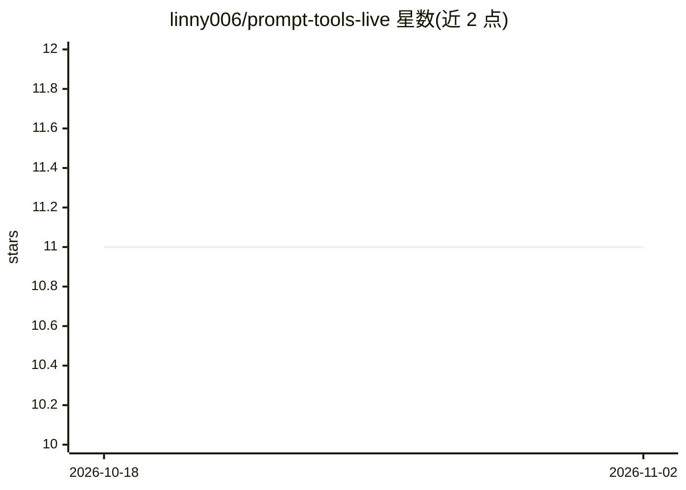

# linny006/prompt-tools-live

⭐ 11 · Python · 推送 2026-10-29 · [GitHub](https://github.com/linny006/prompt-tools-live) · [官网](https://github.com/linny006?utm_source=github&utm_medium=about&utm_campaign=prompt-tools-live) · 个人维护 · 中文 README

**每15分钟自动更新的提示工程工具追踪清单**

由 GitHub Actions 定时任务驱动的 prompt 工程工具/库/技术自动追踪清单：每 15 分钟运行 tracker.py，通过 GitHub Search API 拉取最新仓库，与 data/items.json 快照比对差异后重写表格条目并提交变更，新增条目加入、过期条目移除。数据源仅用公开 GitHub API，无外部服务与付费 API。同一维护者还维护十余个同机制的 live tracker（MCP 服务器、RAG、LLM 评测等方向）。MIT 许可。

## 筛选速览

| 维度 | 判定 | 备注 |
|---|---|---|
| AI 角色 | `ai-knowledge` | 知识聚合/清单类 |
| 许可风险 | `none` | — |
| 部署形态 | `None` |  |
| 模型依赖 | — | README 未给出锁定关系 |
| 硬件要求 | — | 无带数字的原话,不猜 |
| 安装摩擦 | `low` | 无编译、无系统依赖或容器化 |
| 成熟度 | — | 结构信号不足 |

## 能力要点

- 每 15 分钟通过 GitHub Actions 自动刷新条目
- 与上一快照做 diff，仅提交真实变更
- 仅依赖公开 GitHub Search API，无付费服务
- 同一维护者提供十余个同机制的专题 live tracker

## 适用场景

- 持续跟踪 prompt 工程工具与库的最新动态
- 发现新出现的 agent 技能仓库与 prompt 项目
- 替代静态 awesome-list 获取不过期的目录数据

## 场景标签

`提示工程` `精选清单` · 领域:Agent 开发

## 证据(README 行号)

> L3: Live-updating tracker of prompt engineering tools, libraries, and techniques — refreshed every 15 minutes
> L16: Automatically discovers and ranks the newest prompt engineering tools, libraries, and notable prompt repos across G
> L85: Every 15 minutes, a GitHub Action runs `tracker.py`. That script:

## 星数曲线

2026-10-18 11 → 2026-11-02 11（+0）

---
*卡片 v1 · prompt 1.4 · 生成 2026-11-02 · 置信度 high · 依据 README sha `4283f60e0c50` · [字段定义](../../DATASET.md)*
