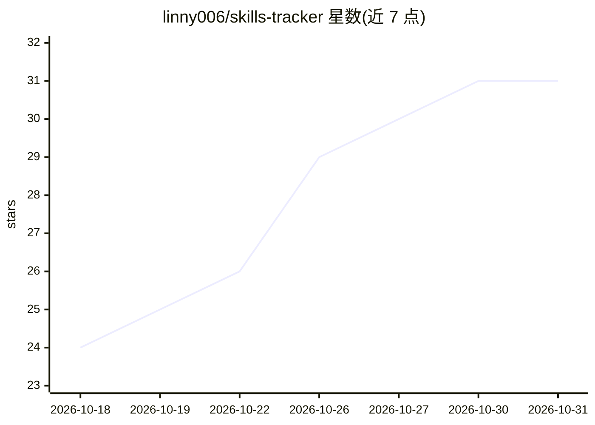

# linny006/skills-tracker

⭐ 31 · Python · 推送 2026-10-29 · [GitHub](https://github.com/linny006/skills-tracker) · 个人维护 · 中文 README

**每15分钟追踪 GitHub 新增 'skills' 仓库的自动更新清单**

由 GitHub Actions 定时任务驱动的实时追踪仓库：每 15 分钟通过 GitHub Search API 搜索名为 'skills' 的新仓库，采集星标数、语言、更新时间与描述，重写条目表格；条目随上游变化新增或移除。面向开发者、投资者与研究者，用于观察 AI agent 技能生态的命名趋势。README 提供英/中/日/韩/西/葡多语言版本，当前收录约百条条目。

## 筛选速览

| 维度 | 判定 | 备注 |
|---|---|---|
| AI 角色 | `ai-knowledge` | 知识聚合/清单类 |
| 许可风险 | `none` | — |
| 部署形态 | `library` | 以包/库形式分发 |
| 模型依赖 | — | README 未给出锁定关系 |
| 硬件要求 | — | 无带数字的原话,不猜 |
| 安装摩擦 | `low` | 无编译、无系统依赖或容器化 |
| 成熟度 | — | 结构信号不足 |

## 能力要点

- GitHub Actions cron 每 15 分钟自动更新
- 数据来源为 GitHub Search API，每次提交对应上游真实变化
- 条目含星标数、语言、更新时间与描述，过期项自动移除
- 提供六种语言的 README

## 适用场景

- 发现新出现的 AI agent skills 仓库
- 跟踪 agent 技能生态的命名与增长趋势
- 按星标和语言筛选值得关注的技能库

## 场景标签

`精选清单` · 领域:学习与行业

## 证据(README 行号)

> L16: A live tracker that monitors GitHub for new repositories named 'skills' every 15 minutes, capturing star counts, la
> L18: This list is **auto-updated every 15 minutes** by a GitHub Actions cron.

## 星数曲线

2026-10-18 24 → 2026-10-31 31（+7）

---
*卡片 v1 · prompt 1.4 · 生成 2026-10-26 · 置信度 mid · 依据 README sha `434432de35ef` · [字段定义](../../DATASET.md)*
