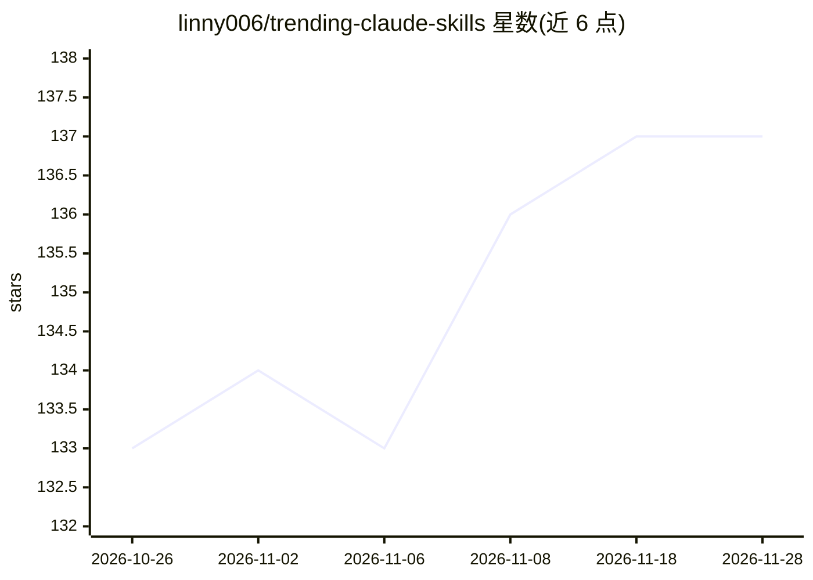

# linny006/trending-claude-skills

⭐ 137 · Python · 推送 2026-11-02 · [GitHub](https://github.com/linny006/trending-claude-skills) · [官网](https://github.com/linny006?utm_source=github&utm_medium=about&utm_campaign=trending-claude-skills) · 个人维护

**每15分钟自动更新的 Claude 技能与 AI agent 仓库排行榜**

通过 GitHub Actions 定时任务每15分钟运行 tracker.py，调用 GitHub Search API 检索新建和更新的 AI coding-agent 技能仓库，按新鲜度与热度而非累计星数排序，将结果表格自动写入 README 形成自更新榜单。仓库本身是数据聚合与展示，不含可安装软件；另有同一维护者的十余个同类自动更新追踪器（MCP 服务器、Cursor 规则、RAG 等）。MIT 许可，无外部服务或付费 API 依赖。

## 筛选速览

| 维度 | 判定 | 备注 |
|---|---|---|
| AI 角色 | `ai-knowledge` | 知识聚合/清单类 |
| 许可风险 | `none` | — |
| 部署形态 | `library` | 以包/库形式分发 |
| 模型依赖 | — | README 未给出锁定关系 |
| 硬件要求 | — | 无带数字的原话,不猜 |
| 安装摩擦 | `low` | 无编译、无系统依赖或容器化 |
| 成熟度 | — | 结构信号不足 |

## 能力要点

- GitHub Actions 定时任务每15分钟自动刷新榜单
- 按新鲜度与热度而非全期星标排序
- 基于 GitHub Search API，无外部服务与付费 API
- 同维护者提供十余个不同主题的自动更新追踪器

## 适用场景

- 追踪最近新建/更新的 Claude 技能与 agent 技能仓库
- 发现新兴 AI coding 工具而非只看高星老项目
- 关注 MCP 服务器、Cursor 规则等生态的最新动态

## 场景标签

`精选清单` · 领域:学习与行业

## 证据(README 行号)

> L16: A live tracker that queries GitHub Search API for recently created and updated AI coding-agent skill repositories, 
> L85: Every 15 minutes, a GitHub Action runs `tracker.py`. That script:

## 星数曲线

2026-10-26 133 → 2026-11-28 137（+4）

---
*卡片 v1 · prompt 1.4 · 生成 2026-11-28 · 置信度 mid · 依据 README sha `951792c70add` · [字段定义](../../DATASET.md)*
