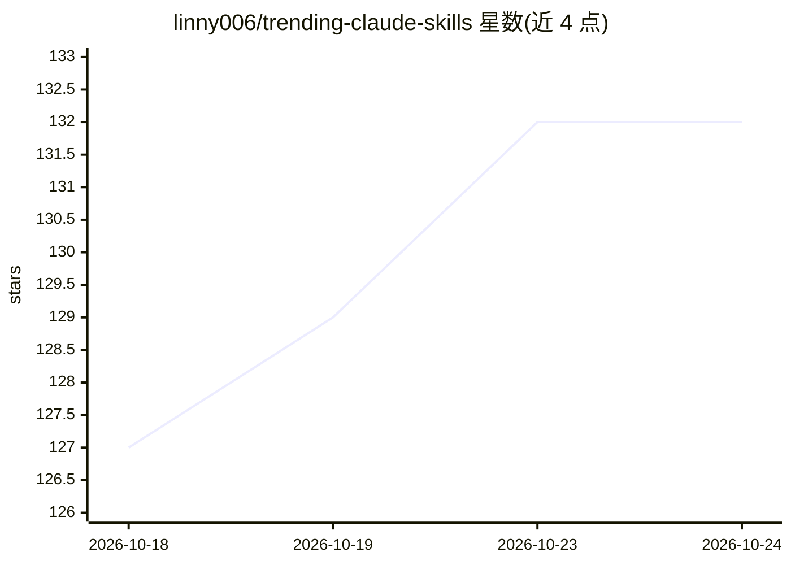

# linny006/trending-claude-skills

⭐ 133 · Python · 推送 2026-10-24 · [GitHub](https://github.com/linny006/trending-claude-skills) · [官网](https://github.com/linny006?utm_source=github&utm_medium=about&utm_campaign=trending-claude-skills) · 个人维护 · 中文 README

**自动更新的 Claude 技能与 AI agent 仓库趋势排行榜**

通过 GitHub Actions 每 15 分钟运行一次 tracker.py，查询 GitHub Search API 获取近期新建或更新的 AI coding-agent 技能仓库，按新鲜度与增长势头（而非累计 star）排序，并自动重写 README 中的排行榜表格；每次提交对应上游数据源的真实变化（新增或移除条目）。无外部服务与付费 API。由个人维护者 linny006 运行，同一维护者还有十余个同机制的 live tracker（MCP 服务器、Cursor rules、RAG 等）。README 提供英/中/日/西/葡多语言版本。

## 筛选速览

| 维度 | 判定 | 备注 |
|---|---|---|
| AI 角色 | `ai-knowledge` | 知识聚合/清单类 |
| 许可风险 | `none` | — |
| 部署形态 | `None` |  |
| 模型依赖 | — | README 未给出锁定关系 |
| 硬件要求 | — | 无带数字的原话,不猜 |
| 安装摩擦 | `medium` | 含编译或系统依赖之一 |
| 成熟度 | — | 结构信号不足 |

## 能力要点

- 每 15 分钟自动刷新，按新鲜度与势头排序而非累计 star
- GitHub Actions + GitHub Search API 实现，无外部服务与付费 API
- 每次提交对应上游数据源的真实变化（新增/移除条目）
- 同一维护者维护十余个同机制的专题 live tracker

## 适用场景

- 跟踪新出现的 Claude 技能与 AI agent 仓库
- 发现近期活跃的 AI coding-agent 技能项目
- 浏览同维护者其他专题（MCP、RAG、LLMOps 等）的动态清单

## 场景标签

`精选清单` · 领域:学习与行业

## 证据(README 行号)

> L16: A live tracker that queries GitHub Search API for recently created and updated AI coding-agent skill repositories, 
> L18: This list is **auto-updated every 15 minutes** by a GitHub Actions cron.

## 星数曲线

2026-10-18 127 → 2026-10-24 132（+5）

---
*卡片 v1 · prompt 1.4 · 生成 2026-10-22 · 置信度 high · 依据 README sha `18a9e71431e7` · [字段定义](../../DATASET.md)*
