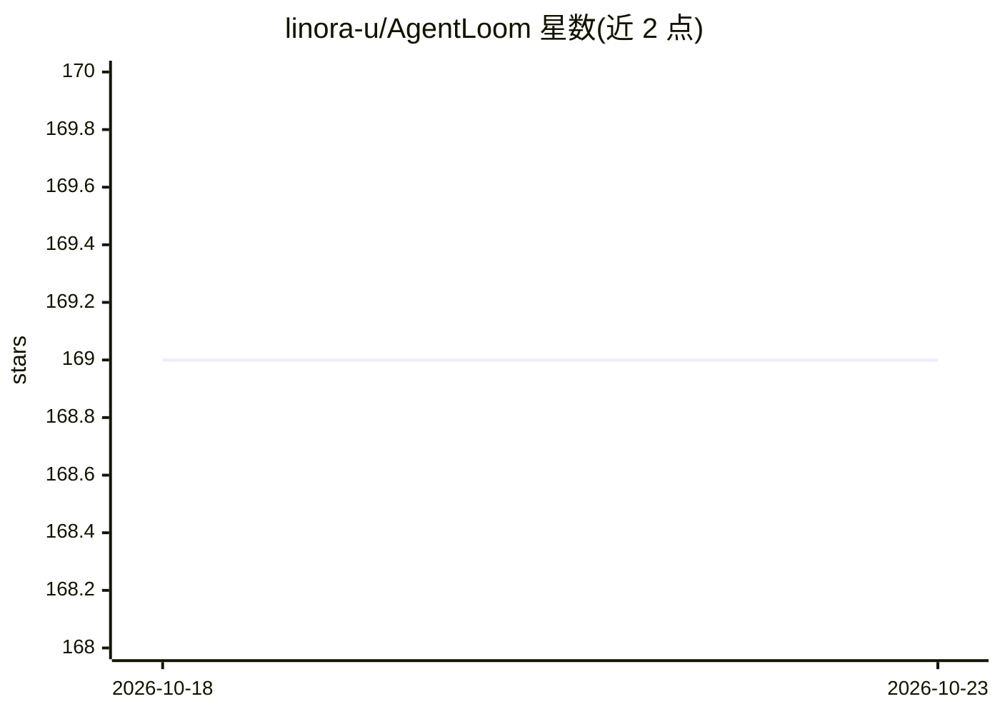

# linora-u/AgentLoom

⭐ 169 · Python · 推送 2026-10-22 · [GitHub](https://github.com/linora-u/AgentLoom) · [官网](https://github.com/linora-u/AgentLoom#readme) · 个人维护 · 中文 README

**面向多智能体应用开发的 YAML 工作流编排框架**

AgentLoom 以'带执行契约的应用'方式构建多智能体系统：用 YAML 定义 Supervisor、带类型 Schema 的 Worker、模型、工具、Skills、Hooks 与权限策略，通过 CLI（agentloom/loom）或 Python API 运行并产出结构化执行证据（run_id、manifest、审计记录、artifacts）。机制上包含 Goal Mode 显式完成所有权与断点恢复、审阅门控的自学习记忆、持久化 Worker 队列（DBOS/SQLite）。安装需 Git/Bash 与 uv，支持 macOS/Linux shell；Linux 的 durable 执行与多主机场景未验证。附带四个示例应用（如十二 Worker 分阶段代码审查）。

## 筛选速览

| 维度 | 判定 | 备注 |
|---|---|---|
| AI 角色 | `ai-ecosystem` | LLM/agent 周边工具 |
| 许可风险 | `none` | — |
| 部署形态 | `None` |  |
| 模型依赖 | — | README 未给出锁定关系 |
| 硬件要求 | — | 无带数字的原话,不猜 |
| 安装摩擦 | `low` | 无编译、无系统依赖或容器化 |
| 成熟度 | — | 结构信号不足 |

## 能力要点

- YAML 定义 Supervisor/Worker/工具/权限，Worker 作为类型化工具被调用
- Run 产出不可变 run_id、生命周期事件与审计证据，支持 resume
- Goal Mode 显式目标完成所有权与检查点恢复
- 审阅门控记忆：事实/经验候选需过证据门，晋升由人发起

## 适用场景

- 用 YAML 编排 Supervisor 与多个类型化 Worker 完成分阶段代码审查
- 构建需断点恢复与执行证据留存的长时间多智能体任务
- 以 JSON/JSONL 事件将应用执行接入外部调度程序

## 场景标签

`Agent 框架` `多智能体` · 领域:Agent 开发

## 证据(README 行号)

> L13: AgentLoom treats a multi-agent system as an **Application with an execution
> L15: Hooks, permissions, and runtime policy. Run Applications through the CLI or
> L193: The Python runtime owns model routing, Worker-tool generation, concurrency,

## 星数曲线

2026-10-18 169 → 2026-10-23 169（+0）

---
*卡片 v1 · prompt 1.4 · 生成 2026-10-22 · 置信度 high · 依据 README sha `0c182ea679a0` · [字段定义](../../DATASET.md)*
