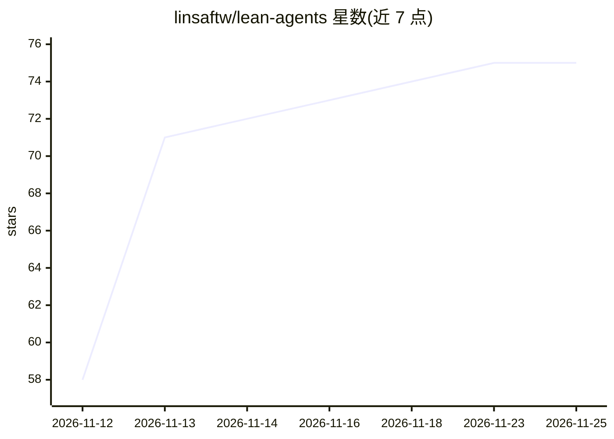

# linsaftw/lean-agents

⭐ 75 · TypeScript · MIT · 推送 2026-11-16 · [GitHub](https://github.com/linsaftw/lean-agents) · 个人维护

**给编码 agent 的精简提示词工作流：共享策略+并行分工**

一套面向编码 agent 的提示词与配置文件集合：以根目录 AGENTS.md 作为共享策略，定义 ORCHESTRATOR（主 agent）与 CODER（工作者）两种角色，主 agent 将功能开发、重构等多文件任务分派给最多 10 个并行 worker，各自在范围内调查、编辑、测试。附带 lean-code/lean-java/lean-web/lean-plan 等按需加载技能文件，以及针对 OpenCode、Claude Code、Codex、Command Code、Pi 的安装说明。README 声明提示词非强制约束，模型可能跳过分派。

## 筛选速览

| 维度 | 判定 | 备注 |
|---|---|---|
| AI 角色 | `ai-ecosystem` | LLM/agent 周边工具 |
| 许可风险 | `permissive` | MIT |
| 部署形态 | `None` |  |
| 模型依赖 | — | README 未给出锁定关系 |
| 硬件要求 | — | 无带数字的原话,不猜 |
| 安装摩擦 | `low` | 无编译、无系统依赖或容器化 |
| 成熟度 | — | 结构信号不足 |

## 能力要点

- AGENTS.md 单一共享策略，定义 ORCHESTRATOR/CODER 双角色
- 最多 10 个 worker 并行处理独立任务
- lean-code/lean-java/lean-web/lean-plan 等按任务加载的技能文件
- 提供 OpenCode、Claude Code、Codex、Command Code、Pi 五种宿主的安装路径

## 适用场景

- 让编码 agent 用更少 token 完成多文件任务
- 在 Claude Code/OpenCode/Codex 等宿主中启用主从分工工作流
- 为 Java/JVM 与 JS/TS 项目加载对应编码技能

## 场景标签

`提示工程` · 领域:Agent 开发

## 证据(README 行号)

> L3: Short prompts for coding agents. Less text per turn, one clear rule set.
> L13: |`ORCHESTRATOR`|Primary agent (`build`)|Small single fixes itself. Features, refactors and multi-file work go to a 

## 星数曲线

2026-11-12 58 → 2026-11-25 75（+17）

---
*卡片 v1 · prompt 1.4 · 生成 2026-11-18 · 置信度 high · 依据 README sha `40262d63a18f` · [字段定义](../../DATASET.md)*
