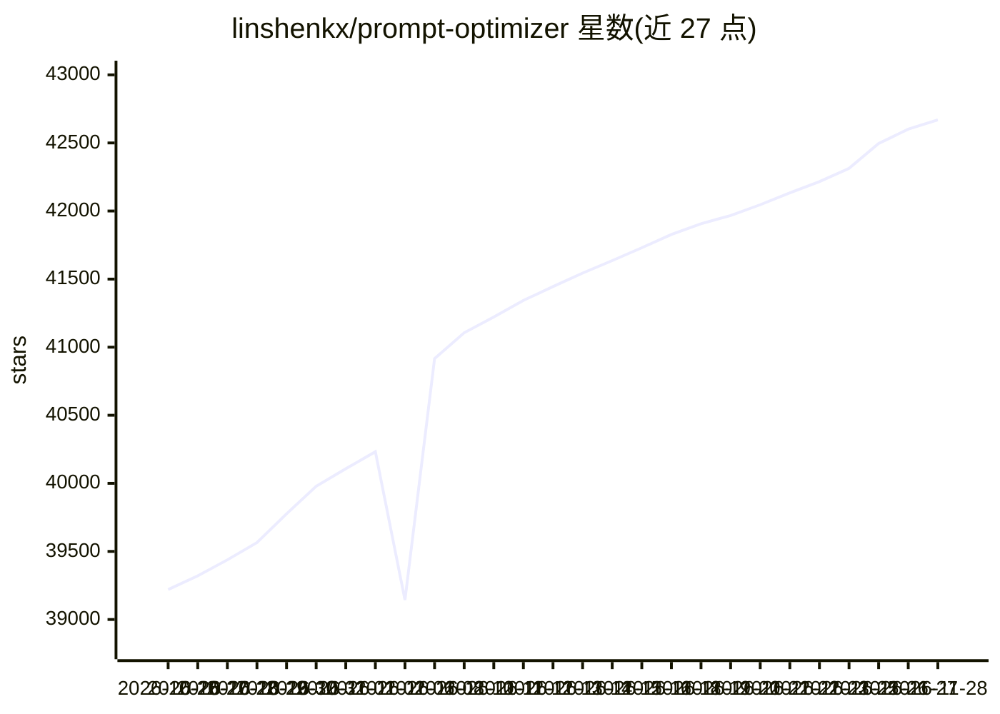

# linshenkx/prompt-optimizer

⭐ 42,669 · TypeScript · NOASSERTION · 推送 2026-11-27 · [GitHub](https://github.com/linshenkx/prompt-optimizer) · [官网](https://prompt.always200.com) · 个人维护 · 中文 README

**帮用户优化与测试 AI 提示词的多平台工具**

Prompt Optimizer 是一款提示词优化工具，提供网页、桌面、Chrome 扩展和 Docker 四种使用方式。核心机制包括：一键优化与多轮迭代改进、系统/用户/变量模板等多种优化模式、同任务多模型并排对比（Arena）、分析与对比评估流水线，以及文本生图（T2I/I2I/多图）模式。提示词可保存为带版本历史与来源绑定的收藏资产，并支持 MCP 协议接入 Claude Desktop 等应用。应用数据默认本地存储，模型请求发往用户自行配置的服务。

## 筛选速览

| 维度 | 判定 | 备注 |
|---|---|---|
| AI 角色 | `ai-native` | 本体是模型或模型工具 |
| 许可风险 | `none` | NOASSERTION |
| 部署形态 | `desktop` | 安装包/桌面程序 |
| 模型依赖 | local-ok | 支持本地模型 |
| 硬件要求 | — | 无带数字的原话,不猜 |
| 安装摩擦 | `low` | 无编译、无系统依赖或容器化 |
| 成熟度 | — | 结构信号不足 |

## 动量与使用信号

- 维护:`active` — 距上次 push 5.2 天,年发版 41,31 位贡献者
- 涨星:近 1 天 **+165**(自 20261016 起算)
- 平台:— · 协议:OPENAI-API / MCP / OLLAMA

## 能力要点

- 一键优化与多轮迭代改进，支持系统/用户/变量模板/多消息上下文模式
- Arena 多模型并排对比与分析、评估驱动的智能重写
- 支持 MCP 协议，提供 optimize-user-prompt 等三个工具
- 数据本地存储；桌面版可连接 Ollama 等本地模型

## 适用场景

- 优化提示词以获得结构更清晰的模型输出
- 用同一提示词在多个模型间对比选择合适模型
- 把可复用提示词沉淀为带版本历史的资产
- 通过 MCP 在 Claude Desktop 中调用提示词优化

## 场景标签

`提示工程` · 领域:Agent 开发

## 证据(README 行号)

> L21: Prompt Optimizer is a powerful AI prompt optimization tool that helps you write better AI prompts and improve the q
> L44: - 🎯 **Intelligent Optimization**: One-click prompt optimization with multi-round iterative improvements to enhance 
> L48: - 🤖 **Multi-model Integration**: Support for mainstream AI models including OpenAI, Gemini, DeepSeek, Grok, Zhipu A

## 星数曲线

2026-10-26 39,220 → 2026-11-28 42,669（+3,449）

---
*卡片 v1 · prompt 1.4 · 生成 2026-11-27 · 置信度 high · 依据 README sha `652e1ff086e3` · [字段定义](../../DATASET.md)*
