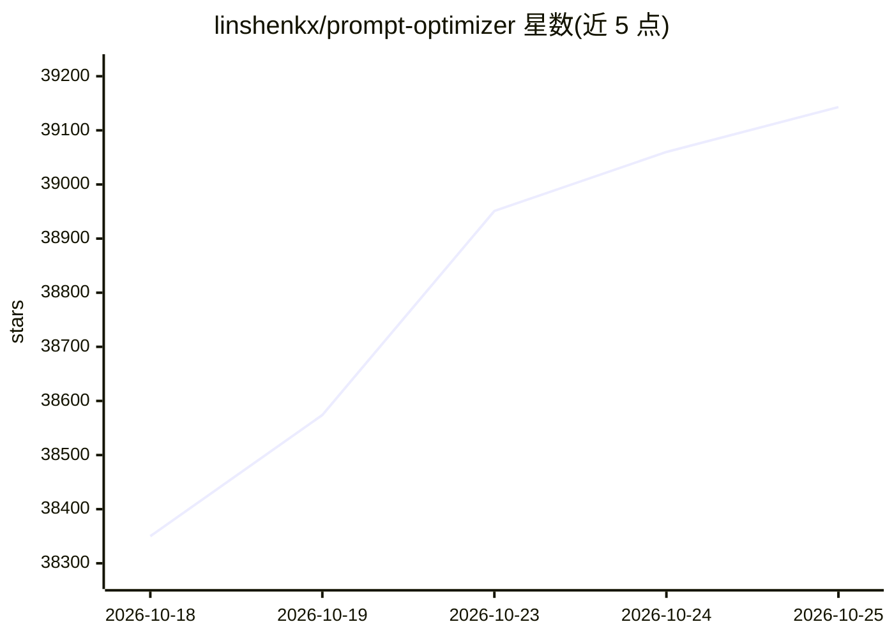

# linshenkx/prompt-optimizer

⭐ 39,143 · TypeScript · NOASSERTION · 推送 2026-10-23 · [GitHub](https://github.com/linshenkx/prompt-optimizer) · [官网](https://prompt.always200.com) · 个人维护 · 中文 README

**提示词优化工具：编写、测试与评估更好的 AI 提示词**

面向使用 AI 模型的用户，提供提示词的优化、测试、评估与收藏管理。支持系统提示词与用户提示词双模式优化、多轮迭代改进、单结果与对比评估、上下文变量与多轮对话测试，并提供文本生成图像提示词的优化。提供网页版、桌面应用、Chrome 扩展与 Docker 四种使用方式，纯客户端处理，数据直接与模型服务商交互；通过 MCP 协议可接入 Claude Desktop 等 AI 应用。使用前需自行配置模型 API key。

## 筛选速览

| 维度 | 判定 | 备注 |
|---|---|---|
| AI 角色 | `ai-ecosystem` | LLM/agent 周边工具 |
| 许可风险 | `none` | NOASSERTION |
| 部署形态 | `desktop` | 安装包/桌面程序 |
| 模型依赖 | local-ok | 支持本地模型 |
| 硬件要求 | — | 无带数字的原话,不猜 |
| 安装摩擦 | `low` | 无编译、无系统依赖或容器化 |
| 成熟度 | — | 结构信号不足 |

## 动量与使用信号

- 维护:`active` — 距上次 push 5.2 天,年发版 41,31 位贡献者
- 涨星:近 1 天 **+165**(自 20261016 起算)
- 平台:— · 协议:OPENAI-API / MCP / OLLAMA

## 能力要点

- 一键优化与多轮迭代改进，支持系统/用户提示词双模式
- 多模型接入：OpenAI、Gemini、DeepSeek、Grok、智谱、SiliconFlow、MiniMax 等
- 文本生成图像（T2I/I2I/多图）提示词优化与模型参数配置
- MCP 协议支持，可集成 Claude Desktop 等 MCP 兼容应用

## 适用场景

- 为不同模型编写并迭代优化提示词
- 通过对比评估判断提示词是否真正改进
- 优化文生图提示词以获得更可控的画面描述
- 通过 MCP 将提示词优化能力接入桌面 AI 应用

## 场景标签

`提示工程` · 领域:Agent 开发

## 证据(README 行号)

> L21: Prompt Optimizer is a powerful AI prompt optimization tool that helps you write better AI prompts and improve the q
> L44: - 🤖 **Multi-model Integration**: Support for mainstream AI models including OpenAI, Gemini, DeepSeek, Grok, Zhipu A
> L52: - 🧩 **MCP Protocol Support**: Supports Model Context Protocol (MCP), enabling integration with MCP-compatible AI ap

## 星数曲线

2026-10-18 38,350 → 2026-10-25 39,143（+793）

---
*卡片 v1 · prompt 1.4 · 生成 2026-10-18 · 置信度 high · 依据 README sha `7e36c689b1ac` · [字段定义](../../DATASET.md)*
