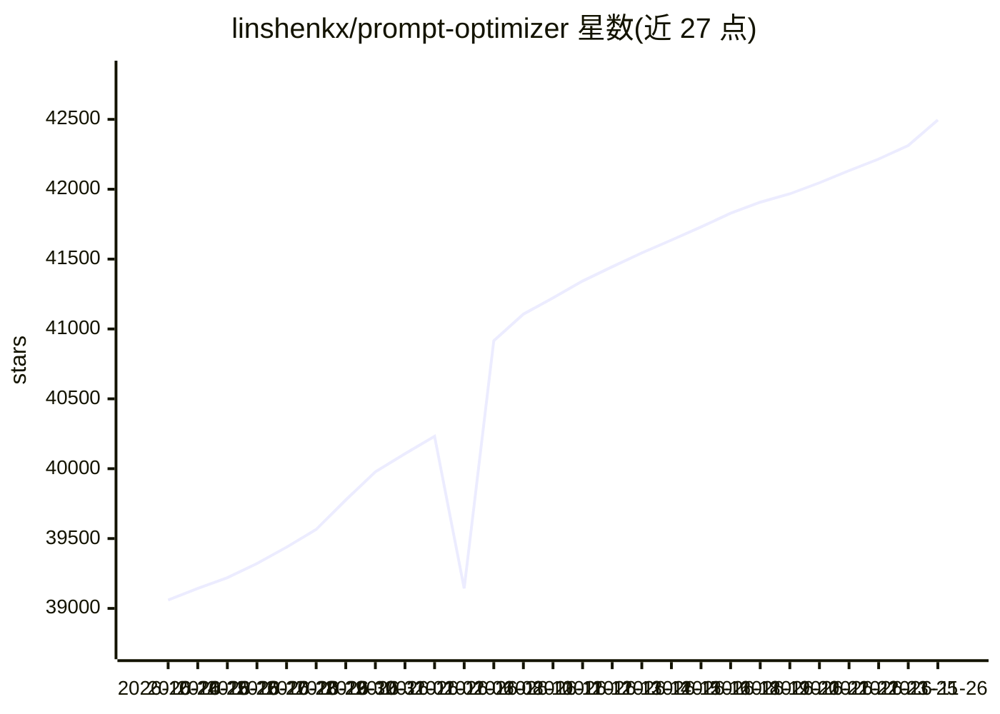

# linshenkx/prompt-optimizer

⭐ 42,496 · TypeScript · NOASSERTION · 推送 2026-11-25 · [GitHub](https://github.com/linshenkx/prompt-optimizer) · [官网](https://prompt.always200.com) · 个人维护

**面向 AI 使用者的提示词优化、测试与评估工具**

Prompt Optimizer 用于编写、优化、测试与评估 AI 提示词，并提供保存为可复用提示词资产的管理功能。支持四种使用方式：Web 应用、桌面应用、Chrome 扩展与 Docker 部署，另提供 MCP Server 供 Claude Desktop 等 MCP 兼容应用集成。功能覆盖多轮迭代优化、变量模板、多模型同题对比（Arena）、分析与对比评估、文生图/图生图提示词模式。数据默认本地存储，模型请求发往用户自行配置的服务；部署时可设置访问密码。

## 筛选速览

| 维度 | 判定 | 备注 |
|---|---|---|
| AI 角色 | `ai-native` | 本体是模型或模型工具 |
| 许可风险 | `none` | NOASSERTION |
| 部署形态 | `desktop` | 安装包/桌面程序 |
| 模型依赖 | local-ok | 支持本地模型 |
| 硬件要求 | — | 无带数字的原话,不猜 |
| 安装摩擦 | `low` | 无编译、无系统依赖或容器化 |
| 成熟度 | — | 结构信号不足 |

## 动量与使用信号

- 维护:`active` — 距上次 push 5.2 天,年发版 41,31 位贡献者
- 涨星:近 1 天 **+165**(自 20261016 起算)
- 平台:— · 协议:OPENAI-API / MCP / OLLAMA

## 能力要点

- 一键优化提示词，支持系统/用户提示词、变量模板与多消息上下文
- Arena 同题多模型对比与评估驱动的智能改写
- 支持 OpenAI、Gemini、DeepSeek、Grok、智谱、SiliconFlow、MiniMax 等模型接入
- MCP 协议支持，可集成 Claude Desktop 等 MCP 应用

## 适用场景

- 优化并对比提示词以改善模型输出的结构与准确性
- 同一提示词投喂多个模型，挑选适合任务的模型
- 将稳定提示词保存为带版本历史的可复用资产
- 通过 MCP 让桌面 AI 应用调用提示词优化能力

## 场景标签

`提示工程` · 领域:Agent 开发

## 证据(README 行号)

> L21: Prompt Optimizer is a powerful AI prompt optimization tool that helps you write better AI prompts and improve the q
> L48: - 🤖 **Multi-model Integration**: Support for mainstream AI models including OpenAI, Gemini, DeepSeek, Grok, Zhipu A
> L56: - 🧩 **MCP Protocol Support**: Supports Model Context Protocol (MCP), enabling integration with MCP-compatible AI ap

## 星数曲线

2026-10-24 39,060 → 2026-11-26 42,496（+3,436）

---
*卡片 v1 · prompt 1.4 · 生成 2026-11-22 · 置信度 high · 依据 README sha `66fdf0b07cb4` · [字段定义](../../DATASET.md)*
