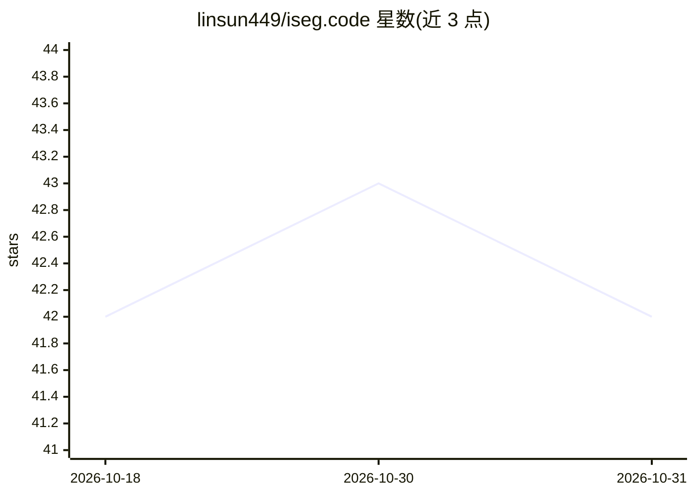

# linsun449/iseg.code

⭐ 42 · Python · 推送 2026-05-25 · [GitHub](https://github.com/linsun449/iseg.code) · [官网](https://linsun449.github.io/iSeg/) · 个人维护 · 中文 README

**基于 Stable Diffusion 自注意力的免训练图像分割框架**

T-PAMI2026 论文 iSeg 的官方实现：利用 Stable Diffusion 2.1-base 的自注意力图，通过迭代细化生成语义分割结果，无需训练即可在单张 5GB 显存 GPU 上运行。引入熵减自注意力模块与类别增强交叉注意力模块，支持零样本、开放词汇及弱监督分割任务，覆盖自然图像、合成图像、剪贴画、绘画、素描等跨域图像。另提供交互式 Demo，可通过点、线、框与文字描述进行分割。以 conda 环境与源码脚本方式运行。

## 筛选速览

| 维度 | 判定 | 备注 |
|---|---|---|
| AI 角色 | `ai-native` | 本体是模型或模型工具 |
| 许可风险 | `none` | — |
| 部署形态 | `None` |  |
| 模型依赖 | — | README 未给出锁定关系 |
| 硬件要求 | — | 无带数字的原话,不猜 |
| 安装摩擦 | `low` | 无编译、无系统依赖或容器化 |
| 成熟度 | — | 结构信号不足 |

## 能力要点

- 免训练迭代细化分割，单张 5GB 显存 GPU 即可运行
- 熵减自注意力模块与类别增强交叉注意力模块
- 支持零样本、开放词汇与弱监督分割任务
- 交互式 Demo 支持点/线/框/文字描述分割

## 适用场景

- 在无标注训练数据条件下做开放词汇语义分割
- 对自然图像及剪贴画、绘画、素描等跨域图像做分割
- 通过点、线、框或文字描述交互式分割目标物体

## 场景标签

`目标检测` · 领域:感知与多模态

## 证据(README 行号)

> L9: - We present a simple iterative training-free segmentation framework using stable diffusion, named
> L10:  iSeg. Based on the self attention maps in stable diffusion model, iSeg provides a more and more
> L52: We provide an interactive demo for you to try our model. The demo can provide segmentation results by points,

## 星数曲线

2026-10-18 42 → 2026-10-31 42（+0）

---
*卡片 v1 · prompt 1.4 · 生成 2026-10-25 · 置信度 high · 依据 README sha `6dc947180afe` · [字段定义](../../DATASET.md)*
