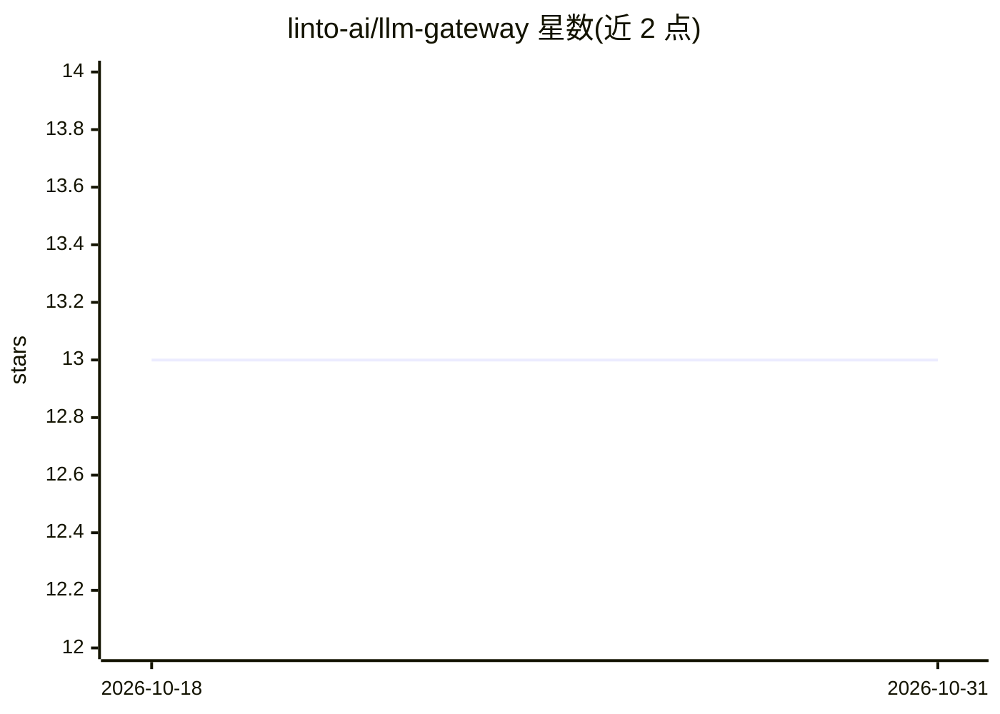

# linto-ai/llm-gateway

⭐ 13 · Python · AGPL-3.0 · 推送 2026-10-19 · [GitHub](https://github.com/linto-ai/llm-gateway) · 组织维护

**面向生产应用的 LLM 编排网关：分块、队列、重试与结果管理**

由 LinTO 维护的内部后端服务，在 LLM 推理引擎之上暴露提取、摘要等高级 API：自动文档分块（单次/迭代两模式）、上下文超限自动回退、提供方故障转移、Celery 异步作业队列与实时进度、token 计数与成本估算、结果缓存与版本化、DOCX/PDF 导出及元数据抽取。无内置鉴权，需部署在应用后端之后；多租户通过 organization_id 隔离。以 Docker Compose 提供 FastAPI + Celery + PostgreSQL + Redis 全栈，配置默认开箱即用。

## 筛选速览

| 维度 | 判定 | 备注 |
|---|---|---|
| AI 角色 | `ai-ecosystem` | LLM/agent 周边工具 |
| 许可风险 | `viral` | AGPL-3.0 |
| 部署形态 | `self-host` | docker 或自建部署 |
| 模型依赖 | — | README 未给出锁定关系 |
| 硬件要求 | — | 无带数字的原话,不猜 |
| 安装摩擦 | `low` | 无编译、无系统依赖或容器化 |
| 成熟度 | — | 结构信号不足 |

## 能力要点

- 单次/迭代双处理模式，超限自动回退与提供方故障转移链
- Celery 作业队列（优先级、WebSocket 实时更新、卡死任务强杀）
- tiktoken/HuggingFace 双 tokenizer 离线安全解析
- 结果缓存、版本化、DOCX/PDF 模板导出与 LLM 元数据抽取

## 适用场景

- 应用后端统一调用 LLM 完成长文档摘要与信息抽取
- 多租户隔离地管理 LLM 作业、成本与结果
- ASR 转写等长文档的分批处理与输出版本管理

## 场景标签

`模型网关` · 领域:Agent 开发

## 证据(README 行号)

> L3: > **TL;DR**: LLM Gateway is an orchestration layer that exposes high-level API services (extraction, summarization, 
> L57: ## How It Compares

## 星数曲线

2026-10-18 13 → 2026-10-31 13（+0）

---
*卡片 v1 · prompt 1.4 · 生成 2026-10-31 · 置信度 high · 依据 README sha `53532cc9370c` · [字段定义](../../DATASET.md)*
