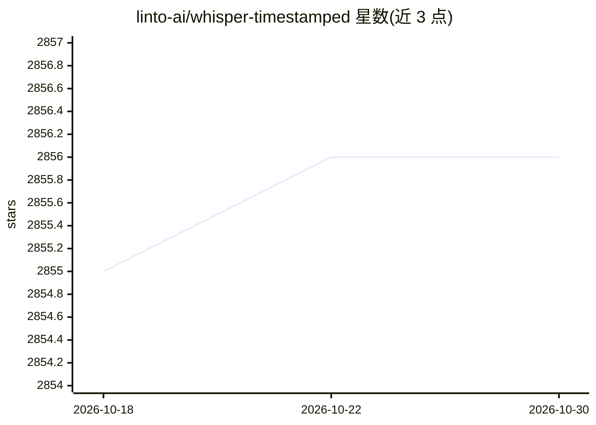

# linto-ai/whisper-timestamped

⭐ 2,856 · Python · AGPL-3.0 · 推送 2026-09-28 · [GitHub](https://github.com/linto-ai/whisper-timestamped) · 组织维护

**为 Whisper 转录添加词级时间戳与置信度的 Python 扩展**

openai-whisper 的 Python 包扩展，通过在交叉注意力权重上应用 Dynamic Time Warping（DTW）实现词级时间戳预测，并为每个词和片段输出置信度分数；多数解码路径下无需额外推理步骤。附加功能包括转写前可选 VAD（silero/auditok）以抑制静音幻觉、语言概率输出、支持加载 Hugging Face 微调模型。提供 Python API 与命令行两种用法，可输出 JSON/CSV/SRT 等格式。README 声明本扩展仅供实验用途，可能明显影响性能。

## 筛选速览

| 维度 | 判定 | 备注 |
|---|---|---|
| AI 角色 | `ai-native` | 本体是模型或模型工具 |
| 许可风险 | `viral` | AGPL-3.0 |
| 部署形态 | `self-host` | docker 或自建部署 |
| 模型依赖 | — | README 未给出锁定关系 |
| 硬件要求 | — | 无带数字的原话,不猜 |
| 安装摩擦 | `low` | 无编译、无系统依赖或容器化 |
| 成熟度 | `idea` | |

## 能力要点

- 基于 DTW 与交叉注意力权重的词级时间戳与置信度计算
- 可选 VAD 前处理（silero/auditok）减少静音上的幻觉输出
- 支持从 Hugging Face Hub 或本地路径加载微调 Whisper 模型
- 输出 JSON/CSV/SRT/VTT/TSV 多种格式，含词级时间戳文件

## 适用场景

- 为字幕（SRT/VTT）生成精确到词的时间轴
- 对转写结果按词置信度做质检或后处理筛选
- 长音频转写时控制内存占用并获得词级对齐
- 加载微调 Whisper 模型做多语言转写并对齐词时间戳

## 场景标签

`语音识别` · 领域:感知与多模态

## 证据(README 行号)

> L3: Multilingual Automatic Speech Recognition with word-level timestamps and confidence.
> L9: Whisper is a set of multi-lingual, robust speech recognition models trained by OpenAI that achieve state-of-the-art 
> L18: `whisper-timestamped` is an extension of the `openai-whisper` Python package and is meant to be compatible with any

## 星数曲线

2026-10-18 2,855 → 2026-10-30 2,856（+1）

---
*卡片 v1 · prompt 1.4 · 生成 2026-10-21 · 置信度 high · 依据 README sha `6279e8bf5cb9` · [字段定义](../../DATASET.md)*
