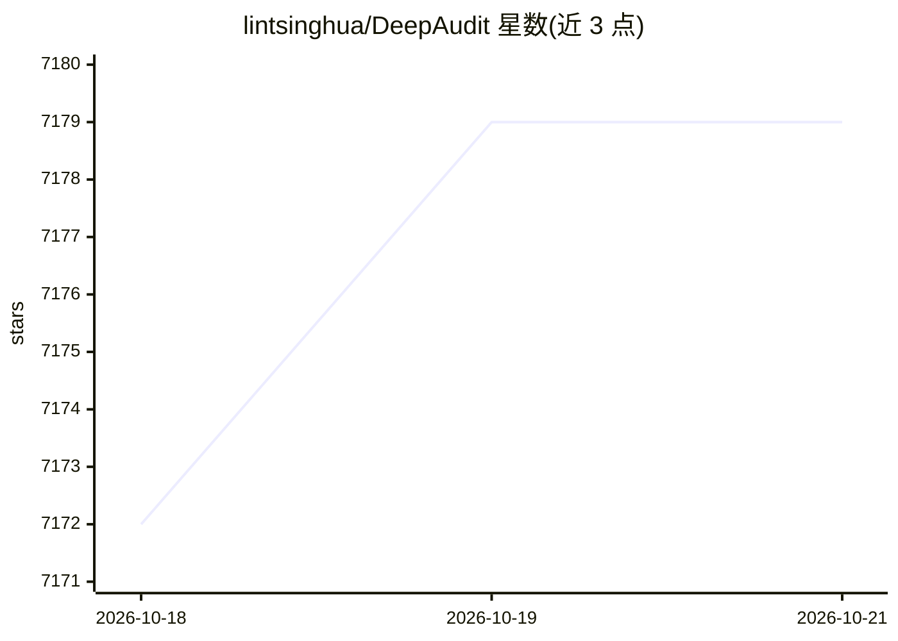

# lintsinghua/DeepAudit

⭐ 7,179 · Python · AGPL-3.0 · 推送 2026-10-16 · [GitHub](https://github.com/lintsinghua/DeepAudit) · 个人维护 · 中文 README

**Multi-Agent 协作的 AI 代码安全审计平台，带沙箱 PoC 验证**

基于 Multi-Agent 架构的代码安全审计平台，由 Orchestrator、Recon、Analysis、Verification 四类智能体协作完成审计流程：识别技术栈、结合 RAG 知识库与 AST 分析挖掘漏洞、在 Docker 沙箱中自动生成并执行 PoC 脚本验证漏洞真实性，失败时自我修正重试，最终剔除误报并导出 PDF/Markdown/JSON 报告。面向需要代码审计的开发者与安全研究人员，支持 15 类漏洞检测、OWASP Top 10 规则与 10+ 语言，可接入 OpenAI/Claude/Gemini/DeepSeek/通义等 LLM 或通过 Ollama 本地部署。README 声明闭源版本曾获得 49 个 CVE 编号；AGPL-3.0 许可，强调仅限授权环境下的研究与教学用途。

## 筛选速览

| 维度 | 判定 | 备注 |
|---|---|---|
| AI 角色 | `ai-native` | 本体是模型或模型工具 |
| 许可风险 | `viral` | AGPL-3.0 |
| 部署形态 | `self-host` | docker 或自建部署 |
| 模型依赖 | local-ok | 支持本地模型 |
| 硬件要求 | — | 无带数字的原话,不猜 |
| 安装摩擦 | `low` | 无编译、无系统依赖或容器化 |
| 成熟度 | — | 结构信号不足 |

## 能力要点

- Orchestrator/Recon/Analysis/Verification 四智能体协作审计流程
- Docker 沙箱中自动生成 PoC 脚本验证漏洞，失败自我修正重试
- RAG 知识库（CWE/CVE）与 AST 分析结合，覆盖 15 类漏洞
- 支持 Ollama 本地部署与 API 中转站，代码可不出内网

## 适用场景

- 导入 GitHub/GitLab 项目做自动化深度安全审计
- 对审计发现的漏洞做沙箱 PoC 验证，区分真实漏洞与误报
- 内网环境用 Ollama 本地模型审计敏感源码
- 粘贴代码片段做即时安全与质量分析

## 场景标签

`多智能体` `代码审查` `网络安全` · 领域:Agent 开发

## 证据(README 行号)

> L130: **DeepAudit** 是一个基于 **Multi-Agent 协作架构**的下一代代码安全审计平台。它不仅仅是一个静态扫描工具，而是模拟安全专家的思维模式，通过多个智能体（**Orchestrator**, **Recon
> L137: 用户只需导入项目，DeepAudit 便全自动开始工作：识别技术栈 → 分析潜在风险 → 生成脚本 → 沙箱验证 → 生成报告，最终输出一份专业审计报告。
> L165: |4|**PoC 验证**|**Verification Agent**|**(关键)** 编写 PoC 脚本，在 Docker 沙箱中执行。如失败则自我修正重试|

## 星数曲线

2026-10-18 7,172 → 2026-10-21 7,179（+7）

---
*卡片 v1 · prompt 1.4 · 生成 2026-10-20 · 置信度 mid · 依据 README sha `cc32bb9303e5` · [字段定义](../../DATASET.md)*
