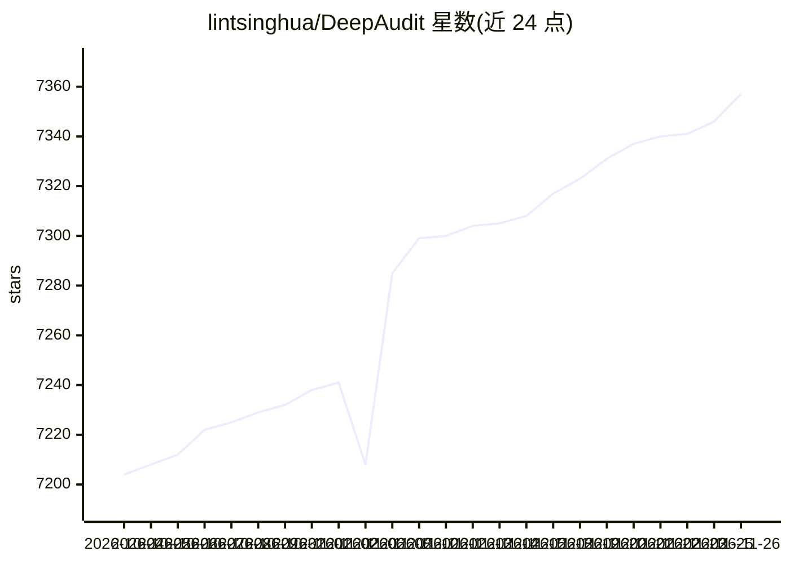

# lintsinghua/DeepAudit

⭐ 7,357 · Python · AGPL-3.0 · 推送 2026-11-25 · [GitHub](https://github.com/lintsinghua/DeepAudit) · 个人维护 · 中文 README

**给安全人员用的 Multi-Agent 代码审计平台，自动挖洞并沙箱验证**

基于 Multi-Agent 协作架构（Orchestrator/Recon/Analysis/Verification）的代码安全审计平台：导入项目后自动识别技术栈、结合 RAG 知识库与 AST 分析挖掘漏洞、在 Docker 沙箱中生成并执行 PoC 验证，最终输出 PDF/Markdown/JSON 审计报告。支持 GitHub/GitLab/Gitea 导入与 ZIP 上传，内置 OWASP Top 10 规则，可接 OpenAI/Claude/Gemini/DeepSeek/Qwen 等 LLM 或通过 Ollama 本地部署。提供 Docker 一行命令部署与源码部署两种方式；README 声明闭源版本曾获 49 个 CVE，并附法律合规与使用限制声明。

## 筛选速览

| 维度 | 判定 | 备注 |
|---|---|---|
| AI 角色 | `ai-native` | 本体是模型或模型工具 |
| 许可风险 | `viral` | AGPL-3.0 |
| 部署形态 | `self-host` | docker 或自建部署 |
| 模型依赖 | local-ok | 支持本地模型 |
| 硬件要求 | — | 无带数字的原话,不猜 |
| 安装摩擦 | `low` | 无编译、无系统依赖或容器化 |
| 成熟度 | — | 结构信号不足 |

## 能力要点

- Multi-Agent 协作审计：策略规划→信息收集→漏洞挖掘→沙箱 PoC 验证→报告生成
- Docker 沙箱自动生成并执行攻击脚本验证漏洞真实性
- 支持 Ollama 本地模型部署，数据不出内网，支持 API 中转站
- 支持 12 类漏洞检测与 RAG（CWE/CVE 知识库）增强，报告一键导出

## 适用场景

- 对企业项目做授权范围内的自动化代码安全审计
- 内网环境下用本地模型审计敏感源码
- 对开源项目做漏洞挖掘并生成验证过的报告

## 场景标签

`多智能体` `代码审查` `网络安全` · 领域:Agent 开发

## 证据(README 行号)

> L130: **DeepAudit** 是一个基于 **Multi-Agent 协作架构**的下一代代码安全审计平台。它不仅仅是一个静态扫描工具，而是模拟安全专家的思维模式，通过多个智能体（**Orchestrator**, **Recon
> L137: 用户只需导入项目，DeepAudit 便全自动开始工作：识别技术栈 → 分析潜在风险 → 生成脚本 → 沙箱验证 → 生成报告，最终输出一份专业审计报告。
> L321: ## 🔌 支持的 LLM 平台

## 星数曲线

2026-10-24 7,204 → 2026-11-26 7,357（+153）

---
*卡片 v1 · prompt 1.4 · 生成 2026-11-26 · 置信度 mid · 依据 README sha `fc78c737113e` · [字段定义](../../DATASET.md)*
