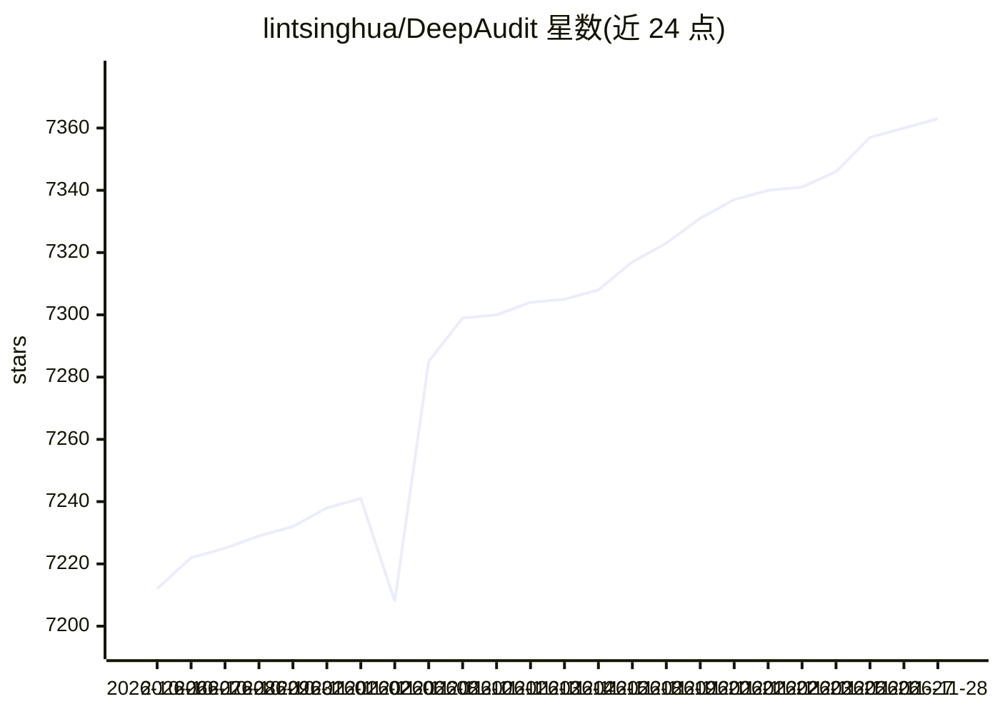

# lintsinghua/DeepAudit

⭐ 7,363 · Python · AGPL-3.0 · 推送 2026-11-27 · [GitHub](https://github.com/lintsinghua/DeepAudit) · 个人维护 · 中文 README

**给开发者/安全人员的 Multi-Agent 代码漏洞审计平台**

基于 Multi-Agent 协作架构的代码安全审计平台，由 Orchestrator、Recon、Analysis、Verification 四类 Agent 协作完成策略规划、攻击面识别、漏洞挖掘与沙箱 PoC 验证，最终生成审计报告。结合 RAG 知识库（CWE/CVE 检索）与 AST 分析，支持 12 类漏洞类型检测、GitHub/GitLab/Gitea 项目导入、PDF/Markdown/JSON 报告导出，运行时可在浏览器配置 LLM。提供 Docker 一行命令部署与源码部署两种方式，支持 API 中转站与 Ollama 本地模型。README 声明仅供授权环境下的研究与教学使用。

## 筛选速览

| 维度 | 判定 | 备注 |
|---|---|---|
| AI 角色 | `ai-native` | 本体是模型或模型工具 |
| 许可风险 | `viral` | AGPL-3.0 |
| 部署形态 | `self-host` | docker 或自建部署 |
| 模型依赖 | local-ok | 支持本地模型 |
| 硬件要求 | — | 无带数字的原话,不猜 |
| 安装摩擦 | `low` | 无编译、无系统依赖或容器化 |
| 成熟度 | — | 结构信号不足 |

## 能力要点

- Orchestrator/Recon/Analysis/Verification 四类 Agent 协作审计，含 Docker 沙箱 PoC 验证
- RAG 知识库增强，支持 CWE/CVE 检索与 AST 分析
- 支持 12 类漏洞类型检测与五维检测（Bug/安全/性能/风格/可维护性）
- 支持 Ollama 本地部署与 API 中转站，代码可不出内网

## 适用场景

- 导入代码仓库做自动化安全审计并生成报告
- 在沙箱中自动验证发现的漏洞是否真实可利用
- 用本地模型对敏感代码做内网私有化审计

## 场景标签

`多智能体` `代码审查` `网络安全` `RAG` · 领域:Agent 开发

## 证据(README 行号)

> L130: **DeepAudit** 是一个基于 **Multi-Agent 协作架构**的下一代代码安全审计平台。它不仅仅是一个静态扫描工具，而是模拟安全专家的思维模式，通过多个智能体（**Orchestrator**, **Recon
> L137: 用户只需导入项目，DeepAudit 便全自动开始工作：识别技术栈 → 分析潜在风险 → 生成脚本 → 沙箱验证 → 生成报告，最终输出一份专业审计报告。
> L147: |**数据隐私担忧** 担心核心源码泄露给云端 AI，无法满足合规要求|**🔒 支持 Ollama 本地部署** 数据不出内网，支持 Llama3/DeepSeek 等本地模型|

## 星数曲线

2026-10-26 7,212 → 2026-11-28 7,363（+151）

---
*卡片 v1 · prompt 1.4 · 生成 2026-11-27 · 置信度 mid · 依据 README sha `9f6a5f3377be` · [字段定义](../../DATASET.md)*
