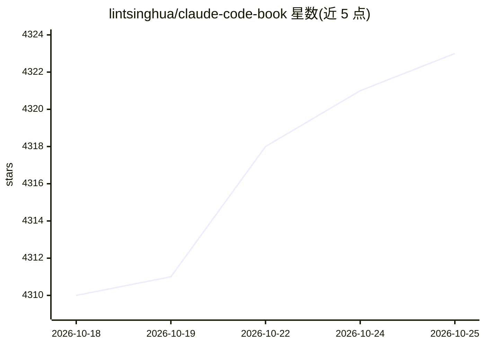

# lintsinghua/claude-code-book

⭐ 4,326 · Python · 推送 2026-10-16 · [GitHub](https://github.com/lintsinghua/claude-code-book) · [官网](https://lintsinghua.github.io) · 个人维护 · 中文 README

**42万字中文书籍：拆解 Claude Code 的 Agent Harness 架构**

独立技术分析书籍《御舆：解码 Agent Harness》，以 15 章 + 4 篇附录剖析 Claude Code 的运行时架构：对话循环、工具系统、权限管线、记忆与上下文管理、钩子、子智能体与多智能体编排、MCP 集成，最后给出从零构建 Agent Harness 的六步路线图。面向希望理解 Agent 运行时内部机制的开发者，声明非 Anthropic 官方出版物，内容区分源码可确认行为与架构推演。文字采用 CC BY-NC-SA 4.0 许可。

## 筛选速览

| 维度 | 判定 | 备注 |
|---|---|---|
| AI 角色 | `ai-knowledge` | 知识聚合/清单类 |
| 许可风险 | `none` | — |
| 部署形态 | `None` |  |
| 模型依赖 | — | README 未给出锁定关系 |
| 硬件要求 | — | 无带数字的原话,不猜 |
| 安装摩擦 | `low` | 无编译、无系统依赖或容器化 |
| 成熟度 | — | 结构信号不足 |

## 能力要点

- 15 章覆盖对话循环、工具系统、权限管线、记忆、上下文压缩、钩子与 MCP 集成
- 末章提供构建自己的 Agent Harness 的六步实现路线图
- 4 篇附录：架构导航地图、50+ 工具清单、89 个功能标志速查、100 条术语表

## 适用场景

- 系统学习 Claude Code 的 Agent Harness 内部架构
- 动手实现自己的 Agent Harness 前建立心智模型
- 按模块（记忆/上下文/权限/MCP）查阅设计机制

## 场景标签

`教程课程` · 领域:学习与行业

## 证据(README 行号)

> L3: Claude Code 架构深度剖析
> L9: 从对话循环、工具调用和权限检查，到记忆、上下文管理与多智能体编排，理解一个 Agent 运行时如何协同工作。全书 15 章、4 篇附录，结合架构图、设计权衡与动手练习，逐步构建自己的 Agent Harness。

## 星数曲线

2026-10-18 4,310 → 2026-10-25 4,323（+13）

---
*卡片 v1 · prompt 1.4 · 生成 2026-10-20 · 置信度 high · 依据 README sha `30709142f884` · [字段定义](../../DATASET.md)*
