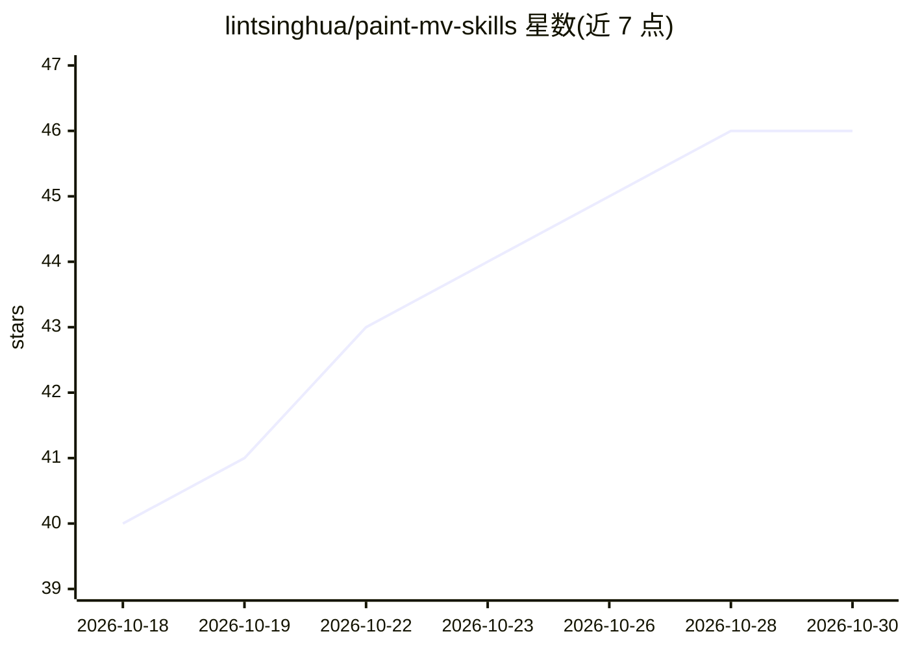

# lintsinghua/paint-mv-skills

⭐ 46 · JavaScript · NOASSERTION · 推送 2026-09-29 · [GitHub](https://github.com/lintsinghua/paint-mv-skills) · [官网](https://github.com/user-attachments/assets/8e291eb1-0761-4abd-b2c0-7ef165dc343a) · 个人维护 · 中文 README

**给 AI Agent 的 MV 制作 skills：歌曲+歌词生成手绘水彩动画 MV**

面向 Claude Code / Cursor 等 Agent 的四个技能包（总控、分镜、动画规范、渲染），按 PDoomVideo 流程把一首歌的音频与歌词转化为手绘水彩风格动画 MV：每帧由 p5.js + p5.brush 在 headless Chrome 中绘制，导演 skill 派发并行章节子代理作画，ffmpeg 编码合成。画风固定，角色与场景每首歌按歌词重新设计。需 Node.js≥18、ffmpeg、Chrome 等；因原作未开源，首次运行时脚本按固定提交拉取 PDoomVideo 源码并打补丁。

## 筛选速览

| 维度 | 判定 | 备注 |
|---|---|---|
| AI 角色 | `ai-ecosystem` | LLM/agent 周边工具 |
| 许可风险 | `none` | NOASSERTION |
| 部署形态 | `None` |  |
| 模型依赖 | — | README 未给出锁定关系 |
| 硬件要求 | — | 无带数字的原话,不猜 |
| 安装摩擦 | `medium` | 含编译或系统依赖之一 |
| 成熟度 | — | 结构信号不足 |

## 能力要点

- 四个 skill 分工：总控/分镜/画师规范/渲染验收
- 每帧为歌曲时间的纯函数，p5.brush 水彩引擎 + headless Chrome 渲染
- 纯文本歌词用 faster-whisper 自动对齐到时间轴
- 原作源码按固定提交拉取并打 template.patch（macOS WebGL、中日韩字体等）

## 适用场景

- 让 Claude Code 或 Cursor 根据歌曲和歌词自动产出一支动画 MV
- 复用固定水彩画风，为不同歌词生成新的角色与分镜
- 参照 demo 全流程复现示例 MV《凌晨录音室》

## 场景标签

`视频生成` `提示工程` · 领域:Agent 开发

## 证据(README 行号)

> L5: 给 AI Agent 用的 MV 制作 skills：输入**一首歌的音频和歌词**，输出**一支手绘水彩风格的动画 MV（MP4）**。
> L63: - Cursor：项目里的 `.cursor/skills/`（本仓库已经用符号链接指向 `skills/`，直接在本仓库里打开就能用）
> L64: - Claude Code：`.claude/skills/` 或 `~/.claude/skills/`（本仓库同样有符号链接）

## 星数曲线

2026-10-18 40 → 2026-10-30 46（+6）

---
*卡片 v1 · prompt 1.4 · 生成 2026-10-25 · 置信度 high · 依据 README sha `fcdf63ccf9e7` · [字段定义](../../DATASET.md)*
