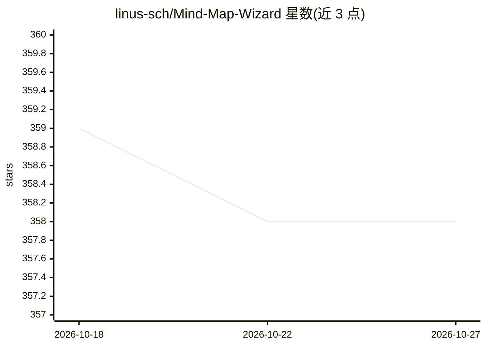

# linus-sch/Mind-Map-Wizard

⭐ 358 · JavaScript · NOASSERTION · 推送 2026-07-19 · [GitHub](https://github.com/linus-sch/Mind-Map-Wizard) · [官网](https://mindmapwizard.com) · 个人维护

**浏览器内运行的 AI 文本生成思维导图工具**

mindmapwizard.com 背后的开源项目：用户输入主题或上传文件，由 LLM（OpenRouter 云端或本地 Ollama）生成结构化大纲，再经自有渲染引擎转为可交互 SVG 思维导图。支持节点展开生成子分支、AI 编辑助手、联网搜索摘要与引用链接。思维导图数据存储在浏览器本地，无需构建步骤，克隆仓库后用任意 HTTP 服务器（Python/Node/VS Code Live Server）即可运行。PDF 上传与联网搜索功能仅限 OpenRouter 云端，本地 Ollama 模式下不可用。

## 筛选速览

| 维度 | 判定 | 备注 |
|---|---|---|
| AI 角色 | `ai-native` | 本体是模型或模型工具 |
| 许可风险 | `none` | NOASSERTION |
| 部署形态 | `library` | 以包/库形式分发 |
| 模型依赖 | local-ok | 支持本地模型 |
| 硬件要求 | — | 无带数字的原话,不猜 |
| 安装摩擦 | `low` | 无编译、无系统依赖或容器化 |
| 成熟度 | — | 结构信号不足 |

## 能力要点

- LLM 从主题/文件生成结构化思维导图并渲染为 SVG
- 支持本地 Ollama 模型离线生成
- 思维导图数据本地存储于浏览器，BYOK 自带 API key
- 无构建步骤的纯静态站点，自有思维导图渲染引擎

## 适用场景

- 快速获取任意主题的可视化知识结构概览
- 研究中逐节点展开分支并让 AI 附带引用摘要深入学习
- 在本地 Ollama 上离线、私密地生成思维导图

## 场景标签

`科研工具` · 领域:学习与行业

## 证据(README 行号)

> L9:  AI-Powered Text to Mind Map Generator
> L49: 1. **Generate your mind map**
> L186: 3. **LLM Analysis** - AI generates structured outline with key concepts

## 星数曲线

2026-10-18 359 → 2026-10-27 358（-1）

---
*卡片 v1 · prompt 1.4 · 生成 2026-10-21 · 置信度 mid · 依据 README sha `c3b404f45942` · [字段定义](../../DATASET.md)*
