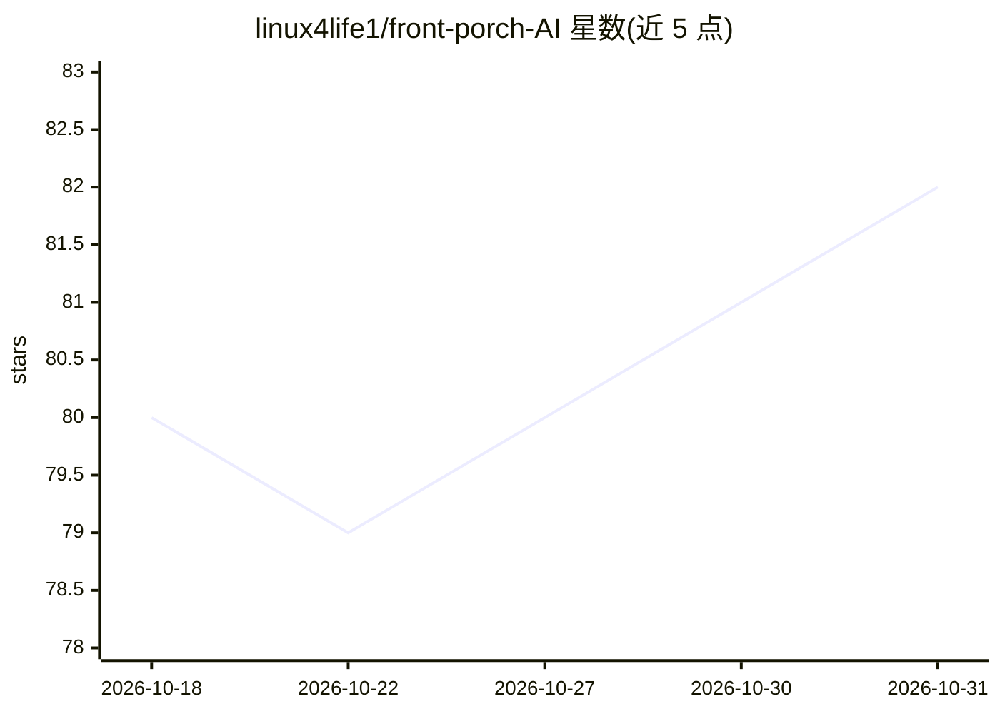

# linux4life1/front-porch-AI

⭐ 82 · Dart · AGPL-3.0 · 推送 2026-10-30 · [GitHub](https://github.com/linux4life1/front-porch-AI) · [官网](https://frontporchai.app) · 个人维护

**本地优先的开源 AI 角色聊天与扮演桌面应用**

用 Flutter 构建的 Windows/macOS/Linux 桌面应用，面向角色扮演聊天用户：默认完全离线运行，可接本地 LLM 后端（KoboldCpp、oMLX、LM Studio 等），也支持 OpenRouter、OpenAI 等远程 API。核心机制包括 Realism Engine（情绪、信任、需求、时间、口袋等可开关的状态模拟）、内置 TTS（Kokoro/Piper/ElevenLabs）与本地图像生成，以及应用内社区角色中心 The Stoop（AGPL-3.0，18+ 门控）。项目自述定位为 Backyard AI 桌面应用关闭后的替代去处，可直接导入 .byaf 存档。

## 筛选速览

| 维度 | 判定 | 备注 |
|---|---|---|
| AI 角色 | `ai-native` | 本体是模型或模型工具 |
| 许可风险 | `viral` | AGPL-3.0 |
| 部署形态 | `desktop` | 安装包/桌面程序 |
| 模型依赖 | locked-api |  |
| 硬件要求 | — | 无带数字的原话,不猜 |
| 安装摩擦 | `medium` | 含编译或系统依赖之一 |
| 成熟度 | — | 结构信号不足 |

## 能力要点

- Realism Engine：情绪/信任/需求/时间/口袋等逐项开关的角色状态模拟
- 内置 TTS（50+ 语音）、Whisper 语音输入与本地图像生成（A1111/Forge/ComfyUI 等）
- 应用内社区角色中心 The Stoop，支持整组角色（成员+世界书+状态）分享
- 默认完全离线，兼容 V2 角色卡与 Backyard .byaf 导入

## 适用场景

- 离线进行角色扮演聊天，不依赖云端服务
- 把 Backyard AI 的角色库存档迁移到本地继续使用
- 在社区中心发现并分享角色卡和整组角色

## 场景标签

`聊天机器人` `图像生成` `语音合成` `语音识别` · 领域:对话与助手

## 证据(README 行号)

> L1: Front Porch AI — a local-first AI companion for character chat &amp; roleplay
> L11: **A local-first AI companion for character chat & roleplay — Windows, macOS, and Linux.** Runs fully offline with l

## 星数曲线

2026-10-18 80 → 2026-10-31 82（+2）

---
*卡片 v1 · prompt 1.4 · 生成 2026-10-24 · 置信度 high · 依据 README sha `63220f4591df` · [字段定义](../../DATASET.md)*
