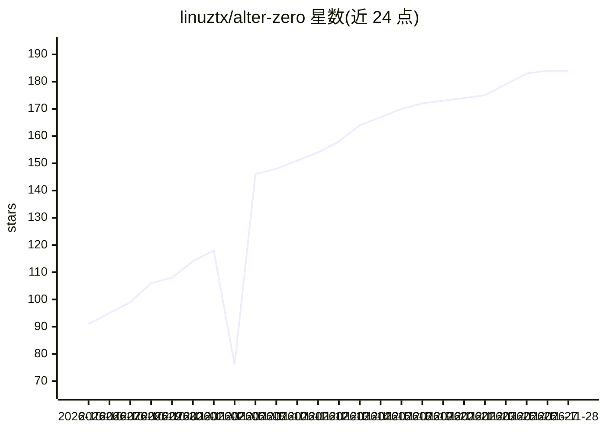

# linuztx/alter-zero

⭐ 184 · Rust · Apache-2.0 · 推送 2026-11-27 · [GitHub](https://github.com/linuztx/alter-zero) · 个人维护

**给终端用的开源编码 agent：读写代码、跑命令、可接本地模型**

Rust 编写的终端 AI agent，灵感来自 Claude Code 与 Codex CLI，在项目目录内读取文件、做编辑、运行命令并检查结果。支持订阅/API/本地模型多种接入方式，提供四档权限模式、审批提示、检查点回滚、子 agent、SKILL.md 技能、MCP 服务器与 headless 单次执行模式。单二进制、小内存占用，Linux/macOS 可用，支持 Docker/Kali 容器运行。

## 筛选速览

| 维度 | 判定 | 备注 |
|---|---|---|
| AI 角色 | `ai-native` | 本体是模型或模型工具 |
| 许可风险 | `permissive` | Apache-2.0 |
| 部署形态 | `library` | 以包/库形式分发 |
| 模型依赖 | local-ok | 支持本地模型 |
| 硬件要求 | — | 无带数字的原话,不猜 |
| 安装摩擦 | `low` | 无编译、无系统依赖或容器化 |
| 成熟度 | — | 结构信号不足 |

## 能力要点

- 四档权限模式与审批提示，可审查 diff 与命令后再执行
- 支持 Ollama/LM Studio 本地模型及任意 OpenAI 兼容 provider 配置
- 子 agent、SKILL.md 技能、hooks 与 MCP 服务器扩展
- headless 模式输出 stdout/JSON 与退出码，可嵌入脚本与 CI

## 适用场景

- 让 agent 定位并修复失败的测试
- 审查仓库中的安全漏洞并追溯到代码
- 用脚本或 cron 对单条 prompt 做 headless 调用
- 在 Kali 容器里做安全研究任务

## 场景标签

`编码 Agent` `网络安全` · 领域:编码与开发

## 证据(README 行号)

> L5: ### Give your terminal a coding agent.
> L37: Alter Zero is an open-source AI coding agent written in Rust, inspired by Claude Code and Codex CLI. It works direc
> L43: |**Your choice of model**|Connect with a supported subscription or API key, run local models with Ollama or LM Stud

## 星数曲线

2026-10-26 91 → 2026-11-28 184（+93）

---
*卡片 v1 · prompt 1.4 · 生成 2026-11-26 · 置信度 high · 依据 README sha `864cb4a787fd` · [字段定义](../../DATASET.md)*
